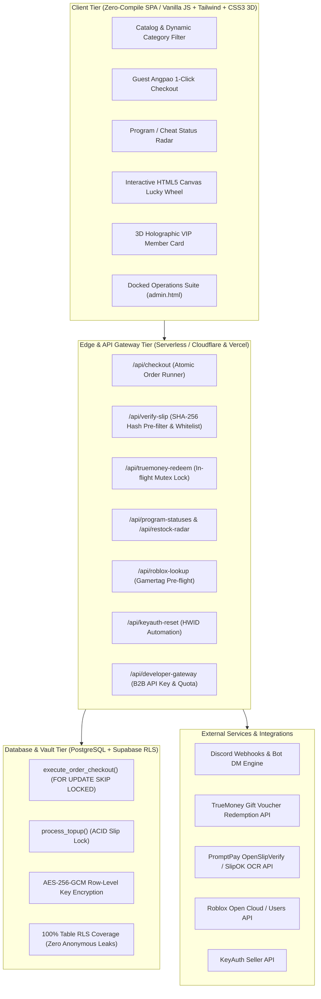

# Gaming Storefront Architect

Production-grade engineering manual and operational playbook for building, hardening, and scaling digital gaming storefronts, automated key dispensers, and gaming e-commerce ecosystems. Distilled from battle-tested production deployments handling high-concurrency peak drops, automated slip fraud attacks, and gaming user psychological funnels.

---

## 1. System Architecture Topology

A production gaming storefront separates concerns across four distinct tiers to eliminate single points of failure, maintain zero-latency storefront rendering, and guarantee cryptographic auditability:



---

## 2. Core Mental Models & Leading Words

When architecting or diagnosing gaming webshops, anchor every design decision to these leading concepts:

- **Atomic Dispenser**: Never query stock on client. Execute stock reservation, item encryption check, payment deduction, and inventory handover inside a single PostgreSQL stored procedure wrapped in `FOR UPDATE SKIP LOCKED`. If any step fails, rollback atomically.
- **Financial Shield**: Multi-barrier defense against slip fabrication:
  1. *SHA-256 Image Hash Cache*: Reject duplicate slips in under 5ms before spending external OCR API credits.
  2. *Receiver Account Whitelist*: Reject slips transferring to foreign or unverified merchant bank accounts.
  3. *Time Freshness Guard*: Reject slips older than 15 minutes.
  4. *Anti-ABC Fraud Watermark*: Overlay dynamic customer/session watermark on PromptPay QR with 70% opacity Base64 to prevent payment interception.
- **Angpao Mutex**: In-memory and database-backed concurrency lock on TrueMoney voucher tokens (`v=XXXXXX`) to prevent race-condition double-claim exploits during burst top-ups.
- **Gamertag Assurance**: Pre-flight verification of player identity (Roblox ID, Discord Snowflake, SteamID64) with avatar rendering before fulfilling non-refundable virtual items.
- **Guest Quick-Commerce**: Remove friction for gamer psychology. Allow 1-click purchases via TrueMoney Angpao without forced account registration, generating instant credential popups and downloadable `.txt` receipts.
- **Tactile Storefront**: Reject generic AI-slop layouts. Enforce signature cyber/obsidian palettes, GPU-accelerated compositing (`clip-path` over CPU masks), tactile spring button physics, and real-time status telemetry.

---

## 3. Financial Shield & Anti-Fraud Implementation

### 3.1 PromptPay Slip Verification Pipeline

Every incoming slip image must pass through a 4-tier validation pipeline:

```javascript
// Pipeline Order: Hash -> Whitelist -> Freshness -> OCR -> Atomic Topup
const crypto = require('crypto');

async function verifySlipPipeline(imageBuffer, amountExpected, merchantAccounts, dbClient) {
  // Step 1: Compute SHA-256 of the raw file
  const slipHash = crypto.createHash('sha256').update(imageBuffer).digest('hex');

  // Step 2: Check database slip hash cache (Pre-OCR fast exit)
  const cached = await dbClient.query('SELECT id, status FROM used_slips WHERE slip_hash = $1', [slipHash]);
  if (cached.rows.length > 0) {
    throw new Error('DUPLICATE_SLIP_HASH: This slip has already been used');
  }

  // Step 3: Call Verified OCR Provider (e.g. OpenSlipVerify / SlipOK)
  const ocrData = await callOcrProvider(imageBuffer);

  // Step 4: Strict Whitelist Assertion on Receiver Account
  const isWhitelisted = merchantAccounts.some(acc => 
    ocrData.receiver.accountNumber.endsWith(acc.accountLastDigits) &&
    ocrData.receiver.bank === acc.bankCode
  );
  if (!isWhitelisted) {
    throw new Error('INVALID_RECEIVER: Money was sent to an unauthorized bank account');
  }

  // Step 5: Time Freshness Assertion (Max 15 minutes old)
  const slipTimestamp = new Date(ocrData.transTimestamp).getTime();
  const maxAgeMs = 15 * 60 * 1000;
  if (Date.now() - slipTimestamp > maxAgeMs) {
    throw new Error('EXPIRED_SLIP: Slip timestamp is older than 15 minutes');
  }

  // Step 6: Atomic Credit Insertion
  return await dbClient.query('SELECT process_topup($1, $2, $3, $4)', [
    ocrData.transRef,
    slipHash,
    ocrData.amount,
    ocrData
  ]);
}
```

### 3.2 Anti-ABC Fraud Dynamic Watermark

Prevent fraudulent buyers from stealing PromptPay QR codes to trick third parties into paying for their orders:

- Generate PromptPay QR payload (`0002010102112937...`).
- Render QR to canvas/SVG at 300x300.
- Overlay a semi-transparent (60-70% opacity) diagonal text banner with:
  `[STORE_NAME] - BUYER: [USER_NAME/IP] - [ORDER_REF] - [TIMESTAMP]`
- Encode as Base64 data URI directly in API response so no external file assets leak.

### 3.3 TrueMoney Angpao Mutex Lock

```javascript
const activeAngpaoLocks = new Set();

async function redeemAngpaoSafe(voucherUrl, userId, dbClient) {
  const token = extractVoucherToken(voucherUrl);
  if (!token) throw new Error('INVALID_VOUCHER_URL');

  // In-flight mutex check
  if (activeAngpaoLocks.has(token)) {
    throw new Error('LOCKED: Angpao voucher is currently being processed');
  }

  activeAngpaoLocks.add(token);
  try {
    // Check DB record for previously completed redemption
    const exist = await dbClient.query('SELECT id FROM angpao_redemptions WHERE voucher_token = $1', [token]);
    if (exist.rows.length > 0) throw new Error('VOUCHER_ALREADY_USED');

    // Call TrueMoney Gateway API
    const result = await callTrueMoneyApi(token);

    // Record redemption atomically
    await dbClient.query('SELECT credit_angpao_balance($1, $2, $3)', [userId, token, result.amount]);
    return result;
  } finally {
    activeAngpaoLocks.delete(token);
  }
}
```

---

## 4. Atomic Stock Engine & Vault Architecture

### 4.1 PostgreSQL ACID Dispenser (`FOR UPDATE SKIP LOCKED`)

Prevent race conditions and out-of-stock ghost sales during burst sales drops:

```sql
CREATE OR REPLACE FUNCTION execute_order_checkout(
    p_user_id UUID,
    p_product_id TEXT,
    p_quantity INT,
    p_price_unit NUMERIC
) RETURNS JSONB
LANGUAGE plpgsql
SECURITY DEFINER
SET search_path = public
AS $$
DECLARE
    v_user_balance NUMERIC;
    v_total_cost NUMERIC;
    v_keys TEXT[];
    v_order_ref TEXT := 'ORD-' || to_char(now(), 'YYYYMMDD-') || upper(substring(gen_random_uuid()::text, 1, 8));
BEGIN
    v_total_cost := p_quantity * p_price_unit;

    -- 1. Lock user row and verify balance
    SELECT balance INTO v_user_balance
    FROM profiles
    WHERE id = p_user_id
    FOR UPDATE;

    IF v_user_balance IS NULL OR v_user_balance < v_total_cost THEN
        RETURN jsonb_build_object('success', false, 'error', 'INSUFFICIENT_BALANCE');
    END IF;

    -- 2. Concurrently lock exactly N available stock items
    WITH available_keys AS (
        SELECT id, content_key
        FROM inventory_keys
        WHERE product_id = p_product_id AND is_sold = FALSE
        ORDER BY created_at ASC
        LIMIT p_quantity
        FOR UPDATE SKIP LOCKED
    )
    UPDATE inventory_keys
    SET is_sold = TRUE,
        sold_to = p_user_id,
        sold_at = now(),
        order_ref = v_order_ref
    FROM available_keys
    WHERE inventory_keys.id = available_keys.id
    RETURNING available_keys.content_key INTO v_keys;

    -- 3. Verify exact quantity secured
    IF array_length(v_keys, 1) IS NULL OR array_length(v_keys, 1) < p_quantity THEN
        RAISE EXCEPTION 'OUT_OF_STOCK: Requested % but only secured %', 
            p_quantity, COALESCE(array_length(v_keys, 1), 0);
    END IF;

    -- 4. Deduct user balance
    UPDATE profiles
    SET balance = balance - v_total_cost
    WHERE id = p_user_id;

    -- 5. Record immutable order
    INSERT INTO orders (order_ref, user_id, product_id, quantity, total_amount, fulfilled_keys, status)
    VALUES (v_order_ref, p_user_id, p_product_id, p_quantity, v_total_cost, v_keys, 'completed');

    RETURN jsonb_build_object(
        'success', true,
        'order_ref', v_order_ref,
        'keys', v_keys,
        'new_balance', v_user_balance - v_total_cost
    );
END;
$$;
```

### 4.2 Bulk Ingestion & Key Deduplication

When uploading bulk licenses/accounts:
1. Split input by newline.
2. Trim and strip carriage returns.
3. Compute `SHA-256` of each key string.
4. Compare against `key_hash` unique index in `inventory_keys`.
5. Insert non-duplicates in a single batch, returning `{ inserted: N, duplicates_skipped: M }`.

---

## 5. Gamer Psychology & Conversion Engineering

### 5.1 Program / Cheat Status Radar

Gamer trust drops immediately when cheats/scripts break after game patches. The storefront must feature a live status hub:

| Status Code | Badge Label | Color Code | Action Constraint |
| :--- | :--- | :--- | :--- |
| `undetected` | 🟢 ปลอดภัย / ใช้งานได้ | Hyper Emerald (`#10B981`) | Normal checkout allowed |
| `updating` | 🟡 กำลังอัปเดต | Electric Amber (`#F59E0B`) | Checkout disabled with Restock Radar button |
| `maintenance` | 🔴 ปิดปรับปรุง | Crimson Red (`#EF4444`) | Checkout disabled with estimated return time |

### 5.2 Guest Angpao Quick Checkout Flow

1. Customer clicks "ซื้อด่วน (Guest Angpao)" on any product card.
2. Modal opens with 2 fields: `TrueMoney Gift Link` and optional `Discord User ID / Email`.
3. Client dispatches to `/api/guest-checkout`:
   - Redeems Angpao via mutex lock.
   - Computes product cost vs redeemed amount.
   - Dispenses key atomically.
   - If voucher amount > price, issues remaining as a credit voucher code.
4. On-screen modal displays key with 1-click copy button and triggers instant `.txt` receipt download.

### 5.3 Gamification Engine (Lucky Wheel Canvas & VIP Tiering)

- **Canvas Spin Wheel**: Physics-driven rotational damping (`requestAnimationFrame`), 8-segment prize distribution, sound/haptic triggers on tick pass.
- **Fair Play Odds**: Stored procedure determines winner **before** wheel animation begins; client animation only visualizes the pre-calculated outcome.
- **Dynamic VIP Member Card**: 3D perspective transform reacting to mouse coordinate `/ pointermove`:
  `transform: perspective(1000px) rotateX(${rotateX}deg) rotateY(${rotateY}deg);`
  Dynamic holographic foil gradient reflecting angle of light.

---

## 6. Automation & External Integrations

### 6.1 Discord Restock DM Radar

- When a product is marked `updating` or `out-of-stock`, buyers click **"เปิดเรดาร์แจ้งเตือน"**.
- API records `{ user_discord_id, product_id, created_at }`.
- When stock is added via Admin Vault or status becomes `undetected`:
  - Worker queries subscribed users.
  - Fires Discord Bot DM webhook:
    `"⚡ สินค้า [PRODUCT_NAME] เติมสต็อกแล้ว! รีบสั่งซื้อก่อนหมด: [LINK]"`
  - Automatically flags notification as delivered.

### 6.2 KeyAuth HWID Reset Automation

For software reseller storefronts integrated with KeyAuth:
- User submits license key and current reason in Self-Service portal.
- API authenticates user ownership.
- Dispatches signed payload to KeyAuth API:
  `GET https://keyauth.win/api/1.2/?type=resetuser&user=[USERNAME]&sellerkey=[SELLER_KEY]`
- Returns confirmation and updates cooldown timer (e.g. 1 reset per 24 hours).

### 6.3 Reseller B2B API Gateway

- Generate API keys (`nyx_live_sk_...`) with SHA-256 hashed storage.
- Rate-limiting via sliding-window token bucket (e.g. 60 requests/minute).
- Quota balance deducted per license key request.

---

## 7. Verification & Empirical Gate (9arm Protocol)

Never deploy or declare a storefront feature ready without terminal test evidence:

```bash
# 1. Verify Database RLS and Function Permissions
node scripts/audit-security.js

# 2. Verify Concurrency & Mutex Defense
node scripts/test-burst-defense.js

# 3. Verify End-to-End Handover & Dynamic CRUD
node scripts/test-handover-autonomy.js
```

### Pre-Delivery Scrutinize Checklist

- [ ] **RLS Coverage**: All database tables have RLS enabled with explicit `WITH CHECK` and `USING` clauses. Direct anonymous access to `inventory_keys` is completely revoked.
- [ ] **Price Integrity**: Client price parameters are ignored by API; all calculations query authoritative DB pricing.
- [ ] **Anti-Tamper**: DevTools/F12 traps do not break legitimate user accessibility or screen readers.
- [ ] **Zero-Latency Render**: Storefront initial payload is self-contained without CDN dependency blocking.
- [ ] **Financial Auditing**: Every topup and order creates immutable audit log entries with client IP, user agent, and cryptographic hash.
