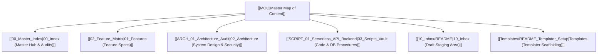

# 📑 NYX9 STUDIO — Master Documentation Hub

Welcome to the **Obsidian Agentic Vault** for **WebShop (NYX9 STUDIO)** — a whitelabel digital storefront engineered for instant, autonomous 24/7 delivery of gaming accounts, Discord Nitro, and digital licenses.

---

## 🗺️ Core Vault Navigation

---

## 🏛️ System Identity & Key Repositories
- **Storefront Name:** NYX9 STUDIO
- **Architecture Model:** Jamstack SPA + Serverless Edge APIs + PostgreSQL (Supabase)
- **Primary Domain:** `https://nyxning.shop/`
- **GitHub Repository:** `https://github.com/MatTew-png/wichx-nyx-storefront`
- **Design System:** Cyberpunk Glacier Cyan (`#00f0ff`, glassmorphism, 60fps micro-interactions)

---

## 📑 Core Documentation Directories

| Directory | Description | Primary Entrypoint |
| :--- | :--- | :--- |
| **`00_Index/`** | Audits, matrices, and git synchronization guides. | [[01_Project_Status_Audit]] |
| **`01_Features/`** | 7 specification documents detailing all storefront capabilities. | [[02_Feature_Matrix]] |
| **`02_Architecture/`** | Security vault, 12-table ERD, roadmap, and live Kanban. | [[ARCH_01_Architecture_Audit]] |
| **`03_Scripts_Vault/`** | Verified source code mappings for API, DB, and QA test scripts. | [[SCRIPT_01_Serverless_API_Backend]] |
| **`10_Inbox/`** | Quarantined raw intake zone for AI drafts and human review. | [[10_Inbox/README]] |
| **`Templates/`** | Standardized Templater templates for features, ADRs, and scripts. | [[Templates/README_Templater_Setup]] |
| **`90_Archive/`** | Historical files and predecessor text documentation. | [[90_Archive/README_Archive]] |

---

## 📊 Live Visual Dashboards
- **Executive Canvas:** `docs/WebShop_Project_Dashboard.canvas`
- **Architecture Canvas:** `docs/WebShop_Architecture.canvas`
- **Interactive Multi-Tier Map:** `docs/WebShop_Full_System.excalidraw.md`
- **Archify Standalone HTML Map:** `02_Architecture/architecture-map.html`
