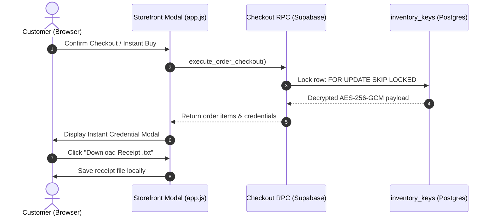

# ⚡ Instant Credential Delivery (FEAT-01)

## 1. 🎯 Overview & User Problem
- **User Pain Point:** Customers purchasing digital goods (such as Discord Nitro or gaming accounts) expect immediate access 24/7 without waiting for a manual admin to wake up or send messages.
- **Solution:** An automated fulfillment pop-up modal (`Instant Key & Credential Delivery Modal`) that triggers immediately upon successful payment verification.
- **Key Capabilities:**
  - One-click copy for credentials formatted as `email:password` or digital license keys.
  - Automated client-side receipt generator (`.txt` file download) containing order reference, timestamp, and product instructions.
  - Integration with [[ARCH_03_Enterprise_Security_Vault|AES-256-GCM]] database decryption.

---

## 2. 🔄 Interaction Flow & Sequence

---

## 3. 🛡️ Security & Anti-Duplication Safeguards
- **Atomic Row-Locking:** Uses `FOR UPDATE SKIP LOCKED` inside `execute_order_checkout` stored procedure so two simultaneous buyers never receive the same inventory key.
- **Client Sanitization:** Modal masks credentials until the customer triggers the reveal toggle or copy button.
- **Decryption at Engine Level:** Keys are stored as ciphertexts with 16-byte authentication tags; only decrypted during checkout.

---

## 4. 🧪 Verification & Test Path
- **UI Test:** Run checkout in dev mode or mock checkout modal in `app.js`.
- **Automated Test:** Run `scripts/test-fulfillment-e2e.js` to verify zero race conditions.
