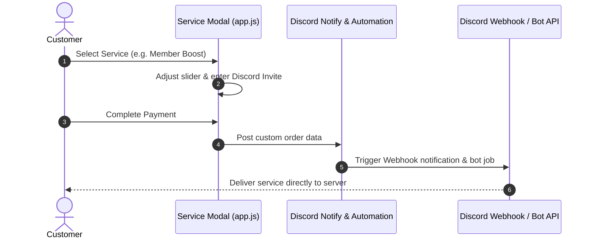

# ⚙️ Custom Discord Service Workflows (FEAT-02)

## 1. 🎯 Overview & User Problem
- **User Pain Point:** Non-standard digital services (such as server member boosts, SMS OTP verification, and automated Discord quest badges) cannot be fulfilled by static license keys. They require user inputs and custom fulfillment parameters.
- **Solution:** A dedicated dynamic modal (`Custom Discord Service Form Modal`) providing dedicated input fields depending on the selected service:
  1. **Discord Member Injection:** Dynamic slider (100 to 1,000 members) with real-time price calculation (฿0.50/member) and invite URL validation.
  2. **Live SMS / OTP Rental:** Provides a dedicated phone number on screen, waits for the incoming SMS verification code, and displays the OTP in real time.
  3. **Discord Quest Badge Automation:** Requires only the Discord User ID / tag; completes quest tasks server-side without requiring the user to download heavy games.

---

## 2. 🔄 Service Processing Sequence

---

## 3. 🛡️ Validation & Constraints
- **Invite Link Sanitization:** Validates `discord.gg/` format and checks link expiration before submission.
- **Slider Bounds:** Minimum 100 members, maximum 1,000 members per single order batch.
- **Honeypot Trap:** Hidden inputs protect the service form against spam bots.

---

## 4. 🧪 Verification & Test Path
- **Manual Verification:** Open Service modal for item ID `dc-members`, test slider step calculation.
- **Test Script:** Run `scripts/test-history-and-services.js` to ensure payload correctly persists in `order_items.service_payload`.
