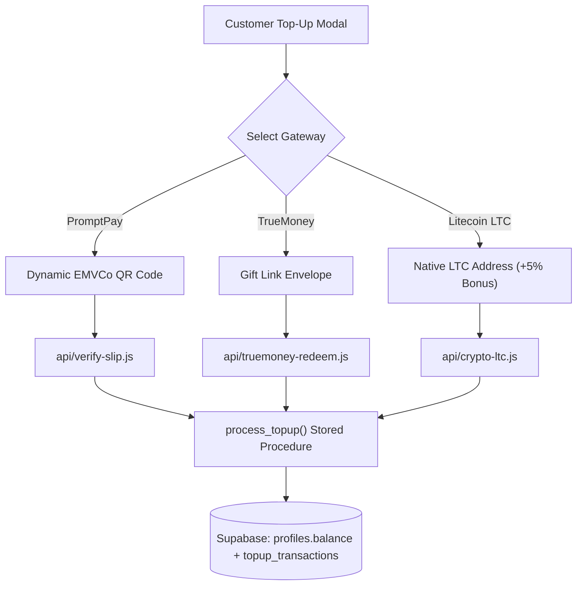

# 💳 Tri-Gateway Payment & Top-Up Engine (FEAT-03)

## 1. 🎯 Overview & User Problem
- **User Pain Point:** Customers have diverse payment preferences. Forcing a single gateway leads to checkout abandonment. Traditional payment processors also take hefty fees or block digital gaming storefronts.
- **Solution:** A hardened multi-gateway modal supporting three instant channels:
  1. **PromptPay (EMVCo QR):** Zero-fee dynamic QR code generation matching the exact transaction total.
  2. **TrueMoney Wallet (Angpao / Gift Voucher):** Customers paste gift envelope links (`gift.truemoney.com`); backend redeems voucher funds instantly into the store account.
  3. **Crypto Litecoin (LTC Native):** Direct blockchain transaction monitoring with zero chargebacks and an automated **+5% wallet bonus** to incentivize crypto adoption.

---

## 2. 🔄 Gateway Architecture & Routing

---

## 3. 🛡️ Anti-Fraud & Double-Spend Defense
- **Unique Transaction References:** All payment references (`slip_trans_ref`, voucher hash, LTC txid) are bound by `UNIQUE` constraints in `used_payment_slips`.
- **Atomic Balance Updates:** Top-up balance additions execute within PostgreSQL transactions (`ACID`).
- **Server-Side Validation:** All values and exchange rates are computed server-side in `/api/`.

---

## 4. 🧪 Verification & Test Path
- **PromptPay Verification:** `node scripts/test-promptpay.js`
- **Top-Up RPC Audit:** `node scripts/test-topup-rpc.js`
- **Full Gateway Suite:** `node scripts/test-api-handlers.js`
