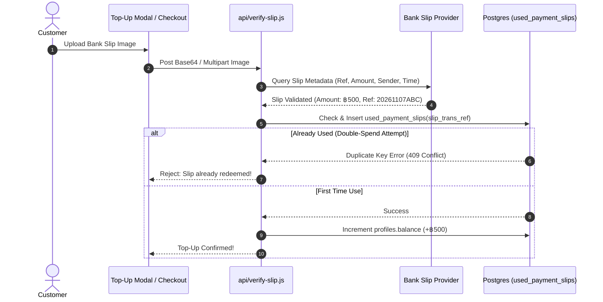

# 📸 Smart Slip Verification & OCR (FEAT-04)

## 1. 🎯 Overview & User Problem
- **User Pain Point:** Manual slip inspection creates long wait times and introduces human error. Typing 25-digit bank transaction reference numbers on mobile leads to customer frustration and abandoned carts.
- **Solution:** Automated slip scanning and validation pipeline:
  - Drag-and-drop or photo upload of bank transfer slips.
  - Client/server QR parsing (EMVCo payload extraction).
  - Backend integration via `api/verify-slip.js` with SlipOK / EasySlip / OpenSlipVerify.
  - Idempotent transaction record validation preventing reused slips.

---

## 2. 🔄 Slip Verification Lifecycle

---

## 3. 🛡️ Security Guardrails
- **Double-Spend Guard:** The database schema enforces `UNIQUE(slip_trans_ref)` in `used_payment_slips`. Any replay attack fails at the database row-lock level.
- **Amount Tamper Prevention:** The credited amount is taken strictly from the verified bank payload, never from the frontend request parameter.
- **Timestamp Threshold:** Slips older than 24 hours are automatically rejected to eliminate recycled receipt fraud.

---

## 4. 🧪 Verification & Test Path
- **Unit Test:** `node scripts/test-promptpay.js`
- **Security Check:** `node scripts/verify-security-empirically.js`
