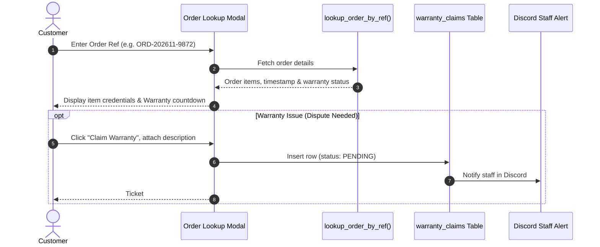

# 🔍 Self-Service Order Lookup & Warranty Dispute (FEAT-06)

## 1. 🎯 Overview & User Problem
- **User Pain Point:** Customers who didn't register or lost their browser window frequently flood support chats asking "Where is my key?" or "My account stopped working, can I get a replacement?".
- **Solution:** 24/7 autonomous order lookup and dispute submission without requiring staff intervention:
  - Customers enter their **Order Reference Number** or registered Discord ID / Email.
  - The system queries Supabase via `lookup_order_by_ref` stored procedure and renders original credentials and receipt details.
  - If a problem occurs within the warranty window, customers click **"Submit Warranty Claim"** right inside the lookup card, recording a dispute in `warranty_claims`.

---

## 2. 🔄 Lookup & Dispute Flow

---

## 3. 🛡️ Security & Privacy Guardrails
- **InitPlan Subquery Filtering:** Customers can only query orders matching their verified email, Discord ID, or signed transaction token.
- **Warranty Expiration Check:** Claims are disabled once the product's guarantee duration (e.g. 7 days, 30 days, 90 days) has elapsed.
- **Rate Limiting:** Prevents brute-force guessing of order reference numbers.

---

## 4. 🧪 Verification & Test Path
- **Stored Procedure Deployment:** `scripts/deploy-lookup-order.js`
- **End-to-End Test:** `scripts/test-history-and-services.js`
