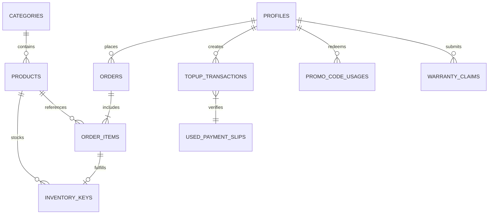

# 🗄️ Database Schema & Relational Cluster (ARCH-04)

This note defines the 12-table relational cluster deployed on Supabase PostgreSQL, detailing entity relationships, foreign keys, and atomic integrity rules.

---

## 1. 📊 Entity-Relationship Diagram (ERD)

---

## 2. 📋 Core Tables Definition

### 1. `profiles`
Primary user table storing wallet balances and linked identity:
- `id` (UUID, PK, references `auth.users`)
- `discord_id` (TEXT, UNIQUE)
- `discord_username` (TEXT)
- `email` (TEXT)
- `balance` (NUMERIC, DEFAULT 0.00, `CHECK (balance >= 0)`)
- `created_at` (TIMESTAMPTZ)

### 2. `categories`
Display categories for the storefront:
- `id` (UUID, PK)
- `name` (TEXT)
- `slug` (TEXT, UNIQUE)
- `sort_order` (INTEGER)

### 3. `products`
Official product catalog:
- `id` (UUID, PK)
- `category_id` (UUID, FK -> `categories.id`)
- `name` (TEXT)
- `price` (NUMERIC)
- `is_active` (BOOLEAN)
- `fulfillment_type` (TEXT: `INSTANT_KEY`, `CUSTOM_SERVICE`, `VOUCHER`)

### 4. `inventory_keys`
Encrypted warehouse for account credentials and digital codes:
- `id` (UUID, PK)
- `product_id` (UUID, FK -> `products.id`)
- `credential_data` (TEXT: encrypted AES-256-GCM ciphertext)
- `is_sold` (BOOLEAN, DEFAULT FALSE)
- `sold_at` (TIMESTAMPTZ)
- `order_id` (UUID, nullable)

### 5. `orders` & `order_items`
Master records and line items:
- `orders`: `id`, `user_id`, `order_ref`, `total_amount`, `payment_method`, `status` (`PAID`, `PENDING`, `REFUNDED`)
- `order_items`: `id`, `order_id`, `product_id`, `unit_price`, `delivered_content`, `service_payload`

### 6. `topup_transactions` & `used_payment_slips`
Financial ledger for deposits:
- `topup_transactions`: `id`, `user_id`, `gateway` (`PROMPTPAY`, `TRUEMONEY`, `LTC`), `amount`, `bonus_amount`, `status`
- `used_payment_slips`: `id`, `slip_trans_ref` (TEXT, UNIQUE), `verified_amount`, `redeemed_at`

### 7. Governance & Audit Tables
- `promo_code_usages`: Tracks coupon redeems (`user_id`, `code`).
- `warranty_claims`: Customer replacement requests (`order_id`, `user_id`, `reason`, `status`).
- `blacklists`: Target values for blocked bad actors (`type`, `target_value`).
- `system_audit_logs`: Immutable security event log (`event_type`, `user_id`, `ip_address`, `payload`).
