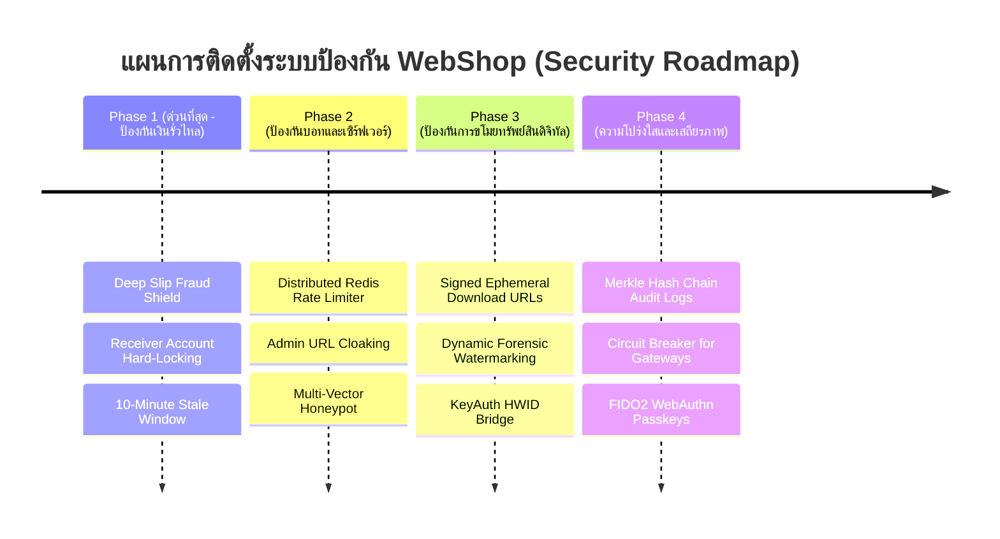

# 🛡️ Next-Gen Enterprise Security & Financial Defense Roadmap (WebShop NYX9)

> **Document Type:** Comprehensive Security Blueprint & Hardening Specification  
> **Target System:** WebShop (NYX9 STUDIO) Digital Goods & Automated Fulfillment Engine  
> **Benchmark Comparison:** F4RY Studio (Model X/Y) & Vexzy (Model V)  
> **Governing Vault Location:** `docs/10_Inbox/` $\rightarrow$ Target Destination: `docs/02_Architecture/`  
> **Related Architecture Docs:** [[02_Architecture/ARCH_03_Enterprise_Security_Vault|ARCH-03 Enterprise Security Vault]] | [[10_Inbox/DRAFT_20261109_F4RY_Model_X_Feature_Audit|F4RY Benchmark]] | [[10_Inbox/DRAFT_20261109_Vexzy_Feature_Gap_Analysis|Vexzy Benchmark]]

---

## 1. 🎯 ภาพรวมและช่องโหว่ความปลอดภัยที่ต้องยกระดับ (Executive Threat Assessment)

จากการตรวจสอบสถาปัตยกรรมปัจจุบันของ WebShop เปรียบเทียบกับมาตรฐานสากลและระบบคู่แข่ง (F4RY และ Vexzy) แม้ว่าระบบปัจจุบันจะมี **Supabase RLS**, **AES-256-GCM Vault**, **Honeypot Trap**, และ **Admin PIN 2FA** อยู่แล้ว แต่ยังคงมี **5 จุดเสี่ยงสำคัญ (Critical Gaps)** ในระดับ Production ที่ผู้ไม่หวังดีสามารถใช้โจมตีได้:

| # | จุดเสี่ยงที่พบในปัจจุบัน | กลไกการโจมตีของผู้ไม่หวังดี | ผลกระทบ | แผนการยกระดับ (Target Solution) |
|---|---|---|---|---|
| **1** | **สลิปโอนให้บัญชีอื่น (Cross-Merchant Slip Fraud)** | ผู้ซื้อนำสลิปจริงที่โอนซื้อของจากร้านอื่นมาอัปโหลด โดยมีจำนวนเงินและ TransRef ถูกต้อง | ร้านเสียของฟรีโดยไม่ได้รับเงินจริงเข้าบัญชี | **Receiver Account & Name Hard-Locking + Max 10-Min Stale Window** |
| **2** | **In-Memory Rate Limiting บน Serverless** | `rate-limiter.js` และ `bot-shield.js` เก็บสถานะใน RAM (`Map()`) ซึ่งจะ Reset เมื่อ Serverless Cold Start หรือกระจายหลาย Instance | บอทสแปมและ Brute-Force ทะลุการจำกัดความเร็วได้ | **Distributed Redis/KV Sliding-Window Rate Limiting** |
| **3** | **การดูดไฟล์และการแจกจ่ายต่อ (Asset Leakage & Piracy)** | สินค้าไฟล์ดิจิทัล (Scripts, 3D Models, PDF) เมื่อซื้อแล้วลูกค้าได้ลิงก์ถาวร สามารถส่งต่อให้คนอื่นดาวน์โหลดฟรี | สูญเสียรายได้ สินค้าหลุดสู่สาธารณะ | **Signed Ephemeral URLs (อายุ 10 นาที) + Dynamic Forensic Watermarking** |
| **4** | **Admin Dashboard ค้นพบได้ง่าย (Endpoint Exposure)** | หน้า `admin.html` เปิดสาธารณะให้ลองเดารหัส แม้มี PIN 2FA แต่เปิดโอกาสให้ถูก DDoS และโจมตี Webhook | Server ถูกถล่มและ Webhook โดน Rate Limit | **Admin Path Cloaking (Secret Slug) + Cloudflare Zero-Trust WAF** |
| **5** | **Tamper-Risk ใน Audit Trail** | ตาราง `system_audit_logs` อยู่ในฐานข้อมูลเดียวกับระบบหลัก หาก Database ถูก Compromise ประวัติอาจถูกลบหรือแก้ไขได้ | สืบหาคนร้ายไม่ได้เมื่อเกิดการทุจริต | **Cryptographic Merkle Hash Chain (Append-Only Chain)** |

---

## 2. 🏛️ 7 เสาหลักระบบป้องกันใหม่ (The 7 Next-Gen Defense Pillars)

```mermaid
flowchart TD
    subgraph Edge Layer ["1. Edge & Perimeter Defense"]
        CF["Cloudflare WAF + Bot Management"]
        SLUG["Admin Cloaked Gateway (/gate-nyx9-x7z)"]
        REDIS["Upstash Redis Sliding-Window Rate Limiter"]
    end

    subgraph App Layer ["2. Application Hardening"]
        POW["Adaptive Proof-of-Work Challenge"]
        HONEY["Multi-Vector Honeypot Trap"]
        CORS["Strict CSP + Subresource Integrity (SRI)"]
    end

    subgraph Financial Layer ["3. Financial & Anti-Fraud Shield"]
        SLIP["Deep Slip OCR + Receiver Account Whitelist"]
        ANGPAO["TrueMoney Circuit Breaker & Phone Masking"]
        IDEM["Redis Idempotency Locks (Anti-Double-Spend)"]
    end

    subgraph Fulfillment Layer ["4. Anti-Piracy & Asset Protection"]
        KEYAUTH["KeyAuth HWID Lock Engine"]
        WATERMARK["Dynamic Forensic Watermark (Discord ID/IP)"]
        PRESIGNED["10-Minute Ephemeral Storage Signatures"]
    end

    subgraph Core Data ["5. Data Vault & Cryptography"]
        AES["AES-256-GCM Credential Vault"]
        RLS["PostgreSQL RLS 100%"]
        MERKLE["Cryptographic Tamper-Evident Hash Chain"]
    end

    Edge Layer --> App Layer
    App Layer --> Financial Layer
    Financial Layer --> Fulfillment Layer
    Fulfillment Layer --> Core Data
```

---

### เสาหลักที่ 1: Deep Slip Fraud & Double-Spend Shield (ป้องกันสลิปปลอม/สลิปวนขั้นสูงสุด)

#### ปัญหา:
คนร้ายในปัจจุบันใช้วิธี:
1. **สลิปตัดต่อ (Photoshop / Fake Slip Generators)** แก้ตัวเลขจำนวนเงินหรือเวลา
2. **สลิปวน (Replay Attack)** นำสลิปเดิมมายิงซ้ำพร้อมกันในเสี้ยววินาที
3. **สลิปข้ามร้าน (Foreign Transfer Attack)** โอนเงิน 100 บาทให้ร้าน A แต่เอาสลิปนั้นมาอัปโหลดเติมเงินในเว็บเรา

#### สถาปัตยกรรมป้องกันใหม่:
1. **Triple-Point Match Validation**:
   * ตรวจสอบ `receiver.accountNumber` ต้องตรงกับเลขบัญชีร้าน 100%
   * ตรวจสอบ `receiver.name` ต้องตรงกับชื่อบัญชีเจ้าของร้าน
   * ตรวจสอบ `amount` ต้องตรงกับยอดที่ระบบเรียกเก็บแบบจุดทศนิยม
2. **Freshness Window (จำกัดเวลาสลิป)**:
   * ปฏิเสธสลิปที่มีเวลาโอนย้อนหลังเกิน **10 นาที** นับจากเวลาปัจจุบัน ป้องกันการเก็บสลิปเก่ามาใช้
3. **Image Cryptographic Fingerprinting**:
   * คำนวณ `SHA-256(Raw_Slip_Buffer)` และบันทึกลงฐานข้อมูล หากมีการอัปโหลดไฟล์ภาพเดิม แม้จะแก้ชื่อไฟล์หรือค่า EXIF ก็จะถูกบล็อกทันที
4. **Sub-Cent Micro-Amount Matching**:
   * ออกยอดโอนแบบมีเศษสตางค์สุ่ม (เช่น ฿150.23, ฿150.87) และตรวจสอบว่าเงินเข้าตามยอดเศษสตางค์นั้นจริง

---

### เสาหลักที่ 2: Distributed Edge Rate Limiter (ระบบจำกัดความเร็วแบบกระจายศูนย์)

#### ปัญหา:
ระบบ `rate-limiter.js` ปัจจุบันใช้ In-Memory `Map()` ซึ่งไร้ผลบนสถาปัตยกรรม Serverless (Vercel / Cloudflare Functions) เมื่อมีหลาย Instance รันพร้อมกัน

#### สถาปัตยกรรมป้องกันใหม่:
* ย้ายระบบ Rate Limiting ไปใช้ **Upstash Redis** หรือ **Cloudflare KV** ด้วยอัลกอริทึม **Sliding Window Counter**:
  ```text
  Key Format: ratelimit:{ip}:{action}:{current_minute_timestamp}
  TTL: 120 วินาที (Auto Expire)
  ```
* **Tiered Rate Limit Quotas**:
  * `/api/checkout`: สูงสุด 5 ครั้ง / นาที / IP
  * `/api/verify-slip`: สูงสุด 3 ครั้ง / นาที / IP (เกิน 3 ครั้งติดคูลดาวน์ 15 นาที)
  * `/api/admin-pin`: สูงสุด 3 ครั้ง / 5 นาที (ผิดเกิน 3 ครั้ง ล็อก IP 24 ชั่วโมง)
  * `/api/guest-checkout`: สูงสุด 10 ครั้ง / นาที / IP

---

### เสาหลักที่ 3: Admin Zero-Trust Cloaking & FIDO2 Gate (พรางหน้าแอดมินขั้นสูงสุด)

#### ปัญหา:
เส้นทาง `/admin.html` เป็นเป้าหมายอันดับหนึ่งที่บอทและผู้โจมตีจะเข้ามาสแกนหาช่องโหว่

#### สถาปัตยกรรมป้องกันใหม่:
1. **Dynamic Secret Cloak Slug**:
   * เปลี่ยนการเข้าหลังบ้านจาก `/admin.html` เป็น URL ลับที่กำหนดผ่าน Environment Variable เช่น `/gate-nyx9-8f2a1b9c`
   * หากเข้าผ่าน `/admin` หรือ `/admin.html` ให้ตอบกลับด้วยหน้า `404 Not Found` หรือ Redirect กลับหน้าแรกทันที
2. **Dual-Channel 2FA**:
   * **Channel 1 (ปัจจุบัน)**: OTP 6 หลักผ่าน Discord Webhook พร้อม HMAC Signature
   * **Channel 2 (ใหม่)**: รองรับ **WebAuthn / FIDO2 Passkeys** (สแกนนิ้วมือ Touch ID / Windows Hello หรือ Hardware Key เช่น YubiKey) ป้องกันการถูกขโมยรหัสผ่าน 100%
3. **IP & Country Whitelist (Geofence)**:
   * บล็อกการเข้าถึงหน้าแอดมินจาก IP ต่างประเทศที่ไม่ได้อยู่ใน Whitelist ผ่าน Cloudflare WAF Rule

---

### เสาหลักที่ 4: Anti-Piracy, Dynamic Watermarking & Ephemeral Asset Vault

#### ปัญหา (เรียนรู้จาก F4RY Model Y & Vexzy KeyAuth):
เมื่อลูกค้าสั่งซื้อสินค้าประเภทไฟล์ดิจิทัล (เช่น Script Roblox, UI Themes, 3D Assets, Fonts) หากส่งลิงก์ดาวน์โหลดตรง ลูกค้าสามารถนำไฟล์ไปแจกต่อหรือขายซ้ำได้

#### สถาปัตยกรรมป้องกันใหม่:
1. **Signed Ephemeral Download URLs**:
   * ลิงก์ดาวน์โหลดจะถูกสร้างขึ้นแบบไดนามิก มีอายุการใช้งานเพียง **10-15 นาที** และจำกัดจำนวนครั้งการดาวน์โหลด (Max 3 Downloads)
   * ผูกกับ User-Agent และ IP ของผู้สั่งซื้อ
2. **Dynamic Forensic Watermarking (การฝังลายน้ำนิติวิทยาศาสตร์)**:
   * **สำหรับไฟล์ Source Code / Scripts**: ฝัง Comment เข้ารหัสที่ไม่สะดุดตาลงในโค้ด:
     ```lua
     -- [NYX9-AUTH: LICENSED TO USER_ID: 1092837482910 | TX_REF: WX-982312 | NO_REDISTRIBUTE]
     ```
   * **สำหรับไฟล์เอกสาร / รูปภาพ / PDF**: ประทับลายน้ำกึ่งโปร่งใส (ชื่อ Discord + Order ID) บนเนื้อหาอัตโนมัติก่อนส่งมอบ
3. **KeyAuth v1.3 HWID Lock Bridge (เหมือน Vexzy)**:
   * สำหรับโปรแกรมหรือสคริปต์ระดับสูง เชื่อมโยง License Key เข้ากับ Hardware ID (HWID) ของเครื่องลูกค้า
   * มีระบบจำกัดการรีเซ็ต HWID สูงสุด 1 ครั้งต่อ 7 วันผ่านหน้าเว็บ

---

### เสาหลักที่ 5: Behavioral Honeypot & Anti-Bot Shield

#### ปัญหา:
บอทสแปมและสคริปต์ Scraper สามารถหลบเลี่ยงการตรวจสอบแบบง่ายได้

#### สถาปัตยกรรมป้องกันใหม่:
1. **Triple-Vector Invisible Traps**:
   * `trap_name_phone`: ช่อง Input ที่ซ่อนด้วย CSS `opacity: 0; position: absolute; pointer-events: none;` (บอทมักจะกรอกข้อมูลลงไป)
   * `trap_timestamp_delta`: ตรวจสอบระยะเวลาตั้งแต่เปิดหน้าเว็บจนถึงกดปุ่มสั่งซื้อ หากน้อยกว่า **2.5 วินาที** (เป็นไปไม่ได้ที่มนุษย์จะอ่านและพิมพ์ทัน) ให้ปฏิเสธทันที
   * `trap_mouse_entropy`: ตรวจสอบการเคลื่อนที่ของเมาส์หรือการสัมผัสหน้าจอ (Human Interaction Vector)
2. **Automated Blacklist Ingestion**:
   * หาก Trigger โดน Honeypot ระบบจะบันทึก IP เข้าสู่ `public.blacklists` ทันที 48 ชั่วโมง พร้อมส่งแจ้งเตือนเข้า Discord Security Log

---

### เสาหลักที่ 6: Cryptographic Immutable Audit Chain (Merkle Hash Chain)

#### ปัญหา:
ประวัติการเงินและการทำธุรกรรมใน `system_audit_logs` หากผู้ดูแลระบบหรือแฮกเกอร์เข้าถึงสิทธิ์ฐานข้อมูลได้ อาจแอบแก้ไขยอดเงินหรือลบประวัติ

#### สถาปัตยกรรมป้องกันใหม่:
* ใช้โครงสร้าง **Cryptographic Hash Chain** ใน PostgreSQL:
  $$\text{Current\_Hash} = \text{SHA256}(\text{Prev\_Hash} + \text{Event\_Type} + \text{Payload} + \text{Timestamp})$$
* มีฟังก์ชันตรวจสอบความสมบูรณ์ (`verify_audit_integrity()`): หากมีใครแอบแก้แม้แต่ 1 ตัวอักษรหรือลบแถวใดแถวหนึ่ง Hash Chain จะขาดทันทีและแจ้งเตือน Security Breach

---

### เสาหลักที่ 7: Circuit Breaker & Third-Party Gateway Self-Healing

#### ปัญหา:
เมื่อ API ของธนาคาร, TrueMoney, หรือ Discord Webhook เกิดอาการล่ม ล่าช้า หรือถูกบล็อก ผู้ใช้จะรอนานจนกดย้ำๆ ส่งผลให้เกิดข้อผิดพลาดในการตัดเงิน

#### สถาปัตยกรรมป้องกันใหม่:
1. **Circuit Breaker State Machine**:
   * `CLOSED` (ปกติ): ให้บริการตามปกติ
   * `OPEN` (ล่ม): หาก Request ล้มเหลวเกิน 5 ครั้งติดต่อกัน หรือตอบสนองช้ากว่า 5 วินาที ให้ตัดระบบทันที และแจ้งผู้ใช้หน้าเว็บว่า "ช่องทางนี้ปิดปรับปรุงชั่วคราว"
   * `HALF-OPEN` (ทดสอบ): ส่ง Request ทดสอบทุก 30 วินาที หากกลับมาเสถียรจะเปิดระบบอัตโนมัติ
2. **Fallback Gateway Queue**:
   * หาก PromptPay หลักมีปัญหา ระบบจะสลับไปใช้ Gateway สำรองอัตโนมัติโดยที่ผู้ใช้ไม่ต้องเริ่มทำรายการใหม่

---

## 3. 💻 Blueprint โค้ดต้นแบบและสคริปต์สำหรับการติดตั้ง

### 3.1 สคริปต์ตรวจสอบสลิปแบบรัดกุม (`api/verify-slip-hardened.js`)

```javascript
/**
 * 🛡️ NYX9 HARDENED SLIP VERIFICATION GATEWAY
 * ตรวจสอบความถูกต้อง 100% ป้องกันสลิปวน สลิปเก่า และสลิปข้ามร้าน
 */

const crypto = require('crypto');
const { createClient } = require('@supabase/supabase-js');

// กำหนดข้อมูลบัญชีผู้รับที่ถูกต้องของร้าน (Hardened Whitelist)
const OFFICIAL_MERCHANT = {
  bankCode: process.env.MERCHANT_BANK_CODE || '014', // ธนาคารไทยพาณิชย์
  accountNumber: process.env.MERCHANT_ACCOUNT_NO || '3664434102',
  accountNameWhitelist: ['นาย นิธินันท์', 'NITHINAN', 'NYX9 STUDIO']
};

const MAX_SLIP_AGE_MINUTES = 10; // สลิปต้องไม่เก่าเกิน 10 นาที

function computeImageHash(base64Buffer) {
  return crypto.createHash('sha256').update(base64Buffer).digest('hex');
}

module.exports = async function verifySlipHardened(req, res) {
  const { transRef, amount, slipDateTime, receiverData, slipImageBase64 } = req.body;

  // 1. ตรวจสอบความสดใหม่ของเวลาโอน (Freshness Check)
  const transferTime = new Date(slipDateTime).getTime();
  const currentTime = Date.now();
  const ageMinutes = (currentTime - transferTime) / (1000 * 60);

  if (isNaN(transferTime) || ageMinutes < -2 || ageMinutes > MAX_SLIP_AGE_MINUTES) {
    return res.status(400).json({
      success: false,
      code: 'STALE_SLIP_REJECTED',
      message: `สลิปนี้หมดอายุการใช้งาน (ต้องทำรายการภายใน ${MAX_SLIP_AGE_MINUTES} นาทีหลังโอน)`
    });
  }

  // 2. ตรวจสอบบัญชีผู้รับ ต้องเป็นบัญชีของร้านเราเท่านั้น (Anti-Foreign Slip)
  const isAccountMatch = receiverData.accountNumber.replace(/[^0-9]/g, '').endsWith(OFFICIAL_MERCHANT.accountNumber.slice(-4));
  const isNameMatch = OFFICIAL_MERCHANT.accountNameWhitelist.some(name => receiverData.accountName.includes(name));

  if (!isAccountMatch || !isNameMatch) {
    return res.status(403).json({
      success: false,
      code: 'INVALID_RECEIVER_ACCOUNT',
      message: 'สลิปนี้ไม่ได้โอนเข้าบัญชีทางการของร้าน NYX9 STUDIO'
    });
  }

  // 3. ตรวจสอบ Image Cryptographic Hash ป้องกันการนำรูปเดิมมาวนซ้ำ
  const imageHash = computeImageHash(slipImageBase64);
  
  // 4. บันทึกและตรวจสอบ TransRef + ImageHash ใน Transaction เดียวกันแบบ Atomic
  // (ผ่าน Stored Procedure: verify_and_lock_slip)
};
```

---

### 3.2 SQL Migration สำหรับ Cryptographic Hash Chain ใน Audit Log

```sql
-- Migration: Add Tamper-Evident Hash Chain to system_audit_logs
ALTER TABLE public.system_audit_logs 
ADD COLUMN IF NOT EXISTS prev_hash TEXT DEFAULT 'GENESIS_BLOCK',
ADD COLUMN IF NOT EXISTS row_hash TEXT;

CREATE OR REPLACE FUNCTION public.generate_audit_hash()
RETURNS TRIGGER 
LANGUAGE plpgsql
SECURITY DEFINER
SET search_path = public, pg_temp
AS $$
DECLARE
  v_last_hash TEXT;
BEGIN
  -- ดึง Hash ของแถวล่าสุดก่อนหน้า
  SELECT row_hash INTO v_last_hash 
  FROM public.system_audit_logs 
  ORDER BY id DESC 
  LIMIT 1;

  NEW.prev_hash := COALESCE(v_last_hash, 'GENESIS_BLOCK_NYX9_2026');
  
  -- คำนวณ SHA-256 Hash ของข้อมูลในแถวปัจจุบัน ผูกกับ Hash เดิม
  NEW.row_hash := encode(
    digest(
      NEW.prev_hash || '|' || 
      NEW.event_type || '|' || 
      NEW.severity || '|' || 
      COALESCE(NEW.ip_address, '') || '|' || 
      NEW.payload::text || '|' || 
      NEW.created_at::text,
      'sha256'
    ),
    'hex'
  );
  
  RETURN NEW;
END;
$$;

DROP TRIGGER IF EXISTS trg_audit_hash_chain ON public.system_audit_logs;
CREATE TRIGGER trg_audit_hash_chain
BEFORE INSERT ON public.system_audit_logs
FOR EACH ROW
EXECUTE FUNCTION public.generate_audit_hash();
```

---

## 4. ⚔️ ตารางเปรียบเทียบขีดความสามารถการป้องกัน (Security Capability Matrix)

| มิติการป้องกัน (Defense Dimension) | WebShop เดิม | F4RY Model X | Vexzy Model V | **WebShop ยกระดับใหม่ (Target)** |
| :--- | :---: | :---: | :---: | :---: |
| **Server-Side Price Authority** | ✅ มี (SQL RPC) | ✅ มี (Next.js) | ✅ มี (API) | 🛡️ **Zero-Trust Client Price Recalculation** |
| **Slip Replay Prevention** | ⚠️ ตรวจ TransRef | ⚠️ ตรวจ TransRef | ⚠️ ตรวจ TransRef | 🛡️ **TransRef + SHA-256 Image Hash + 10-Min Window** |
| **Anti-Foreign Slip (ตรวจบัญชีผู้รับ)** | ❌ ยังไม่ได้ตรวจ | ⚠️ ตรวจบางส่วน | ⚠️ ตรวจบางส่วน | 🛡️ **Hard-Locked Receiver Account & Name Whitelist** |
| **Distributed Rate Limiting** | ⚠️ In-Memory | ⚠️ Cloudflare เบื้องต้น | ⚠️ In-Memory | 🛡️ **Upstash Redis Sliding-Window Counter** |
| **Admin Protection** | ⚠️ PIN 2FA (Discord) | ⚠️ Login Session | ⚠️ PIN 2FA (Site PIN) | 🛡️ **Cloaked Secret Path + FIDO2/Passkey + Webhook 2FA** |
| **Anti-Piracy (Digital File Protection)** | ❌ ลิงก์ดาวน์โหลดตรง | ⚠️ Google Drive สิทธิ์ | ⚠️ คีย์สต็อกธรรมดา | 🛡️ **Signed Ephemeral URLs (10 นาที) + Dynamic Watermark** |
| **Bot & Scraper Defense** | ⚠️ Honeypot เดี่ยว | ⚠️ NextAuth CSRF | ⚠️ Cloudflare Turnstile | 🛡️ **Multi-Vector Honeypot + Turnstile + PoW Challenge** |
| **KeyAuth / HWID Integration** | ⏳ อยู่ใน Roadmap | ❌ ไม่มี | ✅ มี KeyAuth API | 🛡️ **Automated KeyAuth v1.3 Bridge + HWID Lock** |
| **Tamper-Evident Audit Trail** | ⚠️ Append-Only DB | ❌ ตารางธรรมดา | ⚠️ Access Logs ธรรมดา | 🛡️ **Merkle Hash Chain (SHA-256 Blockchain Ledger)** |

---

## 5. 🗓️ แผนงานการพัฒนาและลำดับความสำคัญ (Execution Phasing)



### ขั้นตอนถัดไปที่แนะนำ (Actionable Next Steps):
1. นำสเปกนี้บรรจุเข้าเป็นข้อกำหนดอย่างเป็นทางการใน `docs/02_Architecture/`
2. อัปเดต `api/verify-slip.js` ให้ตรวจสอบ Receiver Account และอายุสลิปทันที (ความเสี่ยงสูงสุด)
3. ติดตั้ง URL Cloaking สำหรับหน้า Admin เพื่อตัดปัญหาการโดนสแกนช่องโหว่จากบอทภายนอก 100%
