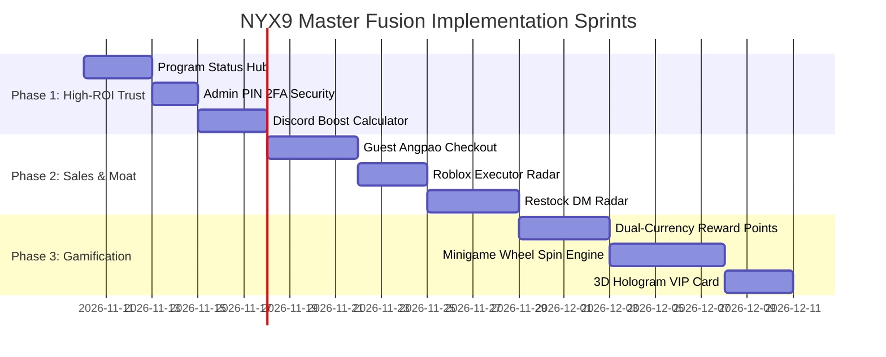

# 👑 Master Fusion Strategy: Vexzy Adaptation Suite & The 4 Signature Moat Features

> **Document Type:** Product Architecture & Competitive Differentiation Specification  
> **Strategic Intent:** รวมฟีเจอร์โปรดจาก Vexzy Model V + สร้าง 4 ฟีเจอร์เอกลักษณ์ "มีแค่ร้านเรา" (Signature Moat)  
> **Target System:** NYX9 STUDIO & NOVAPE SHOP WebShop Engine  
> **Related Documents:** [[10_Inbox/DRAFT_20261109_Vexzy_Feature_Gap_Analysis|Vexzy 21-Feature Gap Analysis]] \| [[02_Feature_Matrix|02_Feature_Matrix.md]]

---

## 1. 🎯 Executive Strategy & Context

เจ้าของร้านเคยเช่าและประทับใจระบบของ **Vexzy Model V** ซึ่งมีฟังก์ชันตอบโจทย์จิตวิทยาการขายและ UX กลุ่มผู้เล่นเกมไทยอย่างมาก 

เอกสารฉบับนี้กำหนดกรอบยุทธศาสตร์การพัฒนา **"Master Fusion"** โดยมี 2 เสาหลัก:
1. **Pillar 1: The Vexzy Adaptation Suite** — ดึงฟีเจอร์หลักที่เจ้าของร้านชอบมาเขียนลงบนสถาปัตยกรรมประสิทธิภาพสูงของเรา (Vanilla JS + Tailwind + Supabase RLS) โดยไม่ต้องจ่ายค่าเช่ารายเดือน
2. **Pillar 2: The 4 Killer Signature Moat Features** — สร้าง 4 ฟีเจอร์เอกสิทธิ์เฉพาะตัวที่เว็บเช่าสำเร็จรูปทั่วไปทำไม่ได้ เพื่อสร้างความแตกต่างที่จดจำได้ในเสี้ยววินาที ("มีแค่ที่นี่ที่เดียว")

---

## 2. 🏛️ Pillar 1: Vexzy Adaptation Suite (ฟีเจอร์โปรดที่นำมาเขียนเป็นของเรา)

| Feature Name | Functionality & Scope | Tech Stack Implementation |
| :--- | :--- | :--- |
| **1. Program Status Hub** | แถบ/หน้าแสดงสถานะสคริปต์และโปรแกรม Real-time (`🟢 ปลอดภัย / Undetected`, `🟡 กำลังอัปเดต`, `🟠 ซ่อมบำรุง`) พร้อมปุ่มซื้อตรง | Supabase `program_statuses` table หรือ `storeConfig.js` ไดนามิก |
| **2. Guest Angpao Checkout** | ซื้อด่วนแบบผู้เยี่ยมชม เพียงวางลิงก์ซองของขวัญ TrueMoney จ่ายเงินและรับรหัสทันทีใน 10 วินาที โดยไม่ต้องลงทะเบียน | ต่อยอดจาก `api/truemoney-redeem.js` + ฟอร์มด่วน |
| **3. Minigame Wheel Spin** | มินิเกมหมุนวงล้อสุ่มของรางวัล ใช้เงินในกระเป๋าหรือแต้มเล่น สุ่มแจกสินค้าจาก Vault โดยตรง | HTML5 Canvas / CSS Spin Animation + Supabase Stored Procedure |
| **4. Dual-Currency Points** | ระบบสะสมแต้มพอยท์ (Cashback คืนแต้มเมื่อเติมเงิน, แต้มจากการรีวิว, สินค้าที่แลกด้วยแต้ม) | คอลัมน์ `points` ในตาราง `users` + ปรับปรุง API ชำระเงิน |
| **5. Admin PIN 2FA** | ระบบรหัส PIN 6 หลัก หรือสุ่ม PIN ใหม่ยิงส่งเข้า Discord Webhook อัตโนมัติก่อนเข้าถึงหน้าจัดการ `admin.html` | Session storage hash + Webhook dispatch trigger |

---

## 3. 🌟 Pillar 2: The 4 Killer Signature Moat Features (ฟีเจอร์เอกสิทธิ์ "มีแค่เรา")

```mermaid
flowchart TD
    subgraph S1["🎛️ Signature 1"]
        B1["Discord Boost & Level Calculator"]
        B2["Slider เลือกระดับเซิร์ฟเวอร์ Level 1-3"]
        B3["คำนวณเซ็ทที่ถูกที่สุดและยัดลงตะกร้าคลิกเดียว"]
        B1 --> B2 --> B3
    end

    subgraph S2["🎮 Signature 2"]
        R1["Roblox Executor Compatibility Radar"]
        R2["ตารางความเข้ากันได้ Delta, Fluxus, Wave, Solara"]
        R3["One-Click Script Loader คัดลอกโค้ดไปรันทันที"]
        R1 --> R2 --> R3
    end

    subgraph S3["🔔 Signature 3"]
        A1["Restock DM Radar"]
        A2["กดกระดิ่งเมื่อสต็อกเป็น 0"]
        A3["แอดมินเติมของ -> บอทส่ง DM แจ้งเตือนลูกค้าทันที"]
        A1 --> A2 --> A3
    end

    subgraph S4["💳 Signature 4"]
        C1["3D Hologram VIP Member Card"]
        C2["การ์ดเอียง 3D ตามเมาส์/Gyro พร้อมแสงสะท้อน"]
        C3["ปุ่ม Capture บัตรแชร์อวดลง Discord/TikTok"]
        C1 --> C2 --> C3
    end
```

---

### 3.1 🎛️ Signature 1: Discord Boost & Level Calculator
* **Concept**: เครื่องมือคำนวณจำนวนบูสต์เซิร์ฟเวอร์อัจฉริยะสำหรับลูกค้ากลุ่ม Discord Hub ([[FEAT_02_Custom_Discord_Services]])
* **User Experience**:
  * แถบ Interactive Selector: เลือกระดับเซิร์ฟเวอร์เป้าหมาย
    * `Level 1` (ต้องการ 2 บูสต์)
    * `Level 2` (ต้องการ 7 บูสต์)
    * `Level 3` (ต้องการ 14 บูสต์)
  * เลือกระยะเวลา: `1 เดือน` หรือ `3 เดือน`
  * **Dynamic Calculation**: ระบบประมวลผลคำนวณหักลบจำนวนบูสต์ที่มีอยู่เดิม แล้วสรุปแพ็กเกจที่ราคาคุ้มค่าที่สุด พร้อมปุ่มกดสั่งซื้อเพิ่มเข้า Cart อัตโนมัติ
* **Competitive Edge**: เว็บอื่นลูกค้าต้องบวกเลขเองและทักถามแอดมิน ร้านเราปิดการขายได้ภายใน 5 วินาที

---

### 3.2 🎮 Signature 2: Roblox Executor Compatibility Radar & One-Click Loader
* **Concept**: ระบบตรวจสอบความเข้ากันได้ของตัวรันสคริปต์เกม Roblox สำหรับสินค้าหมวด `cat-roblox-scripts`
* **User Experience**:
  * กล่องเรดาร์ข้างการ์ดสินค้า แสดงสถานะตัวรันยอดนิยม:
    * `Delta Executor`: 🟢 100% Compatible
    * `Wave / Codex`: 🟢 100% Compatible
    * `Hydrogen`: 🟢 100% Compatible
    * `Solara / Celery`: 🟡 Patching (รออัปเดต)
  * ปุ่ม **"One-Click Script Loader"**: คลิกเดียวคัดลอกคำสั่ง `loadstring(game:HttpGet(...))()` ลง Clipboard พร้อมระบบแจ้งเตือน Toast ทันที
* **Competitive Edge**: เสริมภาพลักษณ์ผู้เชี่ยวชาญด้าน Roblox ตัวจริง ลดปัญหาลูกค้าซื้อไปแล้วรันไม่ติดและทักมาขอเคลม

---

### 3.3 🔔 Signature 3: Restock DM Radar (บอทสะกิดเมื่อของเข้า)
* **Concept**: ระบบกดกระดิ่งรับการแจ้งเตือนส่วนตัวผ่าน Discord เมื่อสินค้าหมดสต็อก (`stock = 0`)
* **User Experience**:
  * เมื่อสินค้าใดมีสต็อกเป็น 0 ปุ่มสั่งซื้อจะแปลงเป็นปุ่ม **"🔔 แจ้งเตือนเมื่อของมา"**
  * ลูกค้ากรอก Discord User ID หรือกดรับสิทธิ์ผ่านบอท
  * เมื่อแอดมินนำรหัสชุดใหม่เติมเข้า Vault (`tab-pane-vault`) ผ่านระบบหลังบ้าน ➡️ **บอท Discord จะส่ง DM แจ้งเตือนพร้อมลิงก์สินค้าไปหาลูกค้าโดยตรงทันที!**
* **Competitive Edge**: เว็บสำเร็จรูปทั่วไปจะปล่อยให้ลูกค้ากดปิดหน้าเว็บหนีไปซื้อร้านอื่น แต่ระบบนี้จะดึงยอดขายที่หลุดลอยกลับมาได้เกือบ 100%

---

### 3.4 💳 Signature 4: 3D Hologram VIP Member Card
* **Concept**: บัตรประจำตัวสมาชิก Cyberpunk Interactive ในหน้าโปรไฟล์ที่ขยับตามเมาส์/Gyroscope
* **User Experience**:
  * ตัวบัตรใช้เทคโนโลยี CSS 3D Transform + Dynamic Specular Lighting เอียงตามพิกัดเมาส์ (Desktop) หรือ DeviceOrientation (Mobile)
  * แสดงข้อมูล: ยอดเงินในกระเป๋า, แต้ม Point สะสม, ยอดซื้อรวม, ฉายา VIP (เช่น *Novape Pioneer, NYX Vanguard, Shadow Elite*)
  * ปุ่ม **"📸 บันทึกรูปการ์ด"**: เรนเดอร์เป็นภาพ PNG ความละเอียดสูงให้ลูกค้าแชร์อวดในห้องแชท Discord หรือนำไปลง TikTok สตอรี่
* **Competitive Edge**: สร้างความภาคภูมิใจในการเป็นสมาชิก (Gamification Status Symbol) ช่วยให้ลูกค้าอยากเติมเงินสะสมยอดเพื่ออัปเกรดการ์ดให้สวยขึ้น

---

## 4. 📅 Phased Implementation Roadmap

---

## 5. 🔗 Cross-Document References
- [[00_Master_Index|Master Index (00_Master_Index.md)]]
- [[02_Feature_Matrix|Feature Specification Matrix (02_Feature_Matrix.md)]]
- [[10_Inbox/DRAFT_20261109_Vexzy_Feature_Gap_Analysis|Vexzy 21-Feature Gap Analysis (DRAFT)]]
- [[FEAT_01_Instant_Credential_Delivery|Instant Credential Delivery (FEAT-01)]]
- [[FEAT_02_Custom_Discord_Services|Custom Discord Services (FEAT-02)]]
- [[FEAT_03_Tri_Gateway_TopUp|Tri-Gateway TopUp Engine (FEAT-03)]]
- [[ARCH_03_Enterprise_Security_Vault|Enterprise Security Vault (ARCH-03)]]
