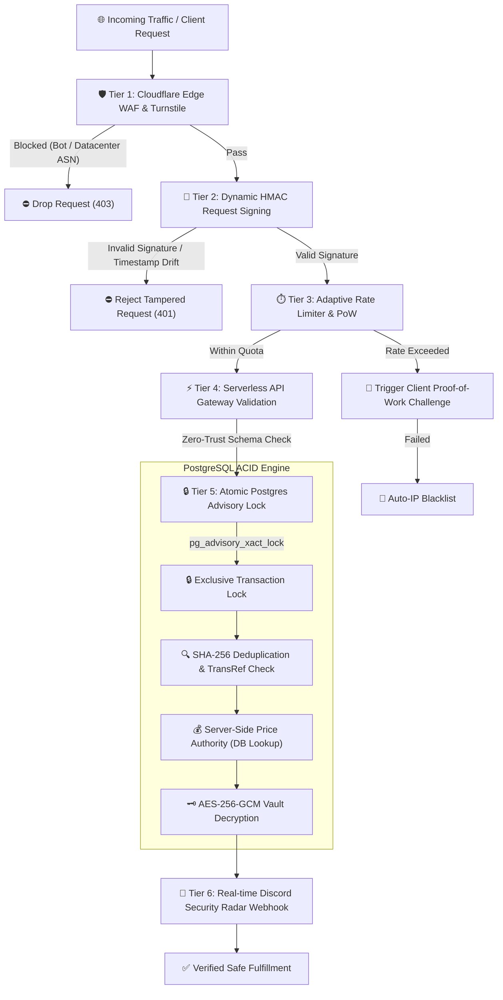
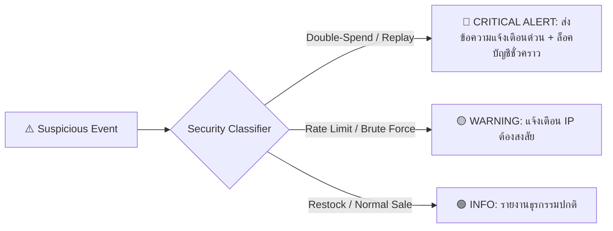

# 🛡️ Next-Gen Enterprise Security & Financial Defense Architecture (WebShop NYX9)

> **Document Type:** Comprehensive Security Engineering Blueprint & Defense Upgrade Specification  
> **Target System:** WebShop NYX9 Storefront, Serverless Edge APIs & Supabase PostgreSQL Core  
> **Related Documents:** [[02_Architecture/ARCH_03_Enterprise_Security_Vault|ARCH-03 Security Vault]] | [[10_Inbox/DRAFT_20261109_F4RY_Model_X_Feature_Audit|F4RY Benchmark Audit]] | [[02_Feature_Matrix|Feature Matrix]]

---

## 1. 🎯 Executive Overview & Threat Landscape

จากการเจาะลึกโครงสร้างระบบของคู่แข่งในตลาด (Vexzy Model V และ F4RY Model X) พบว่าช่องโหว่และจุดเสี่ยงสูงสุดของระบบ E-Commerce สินค้าดิจิทัลในไทยประกอบด้วย **5 ภัยคุกคามหลัก (Top 5 Attack Vectors)**:

1. **Financial Race Conditions (Double-Spend Attack):** การยิงคำขอเติมเงินหรือตัดสต็อกซ้ำพร้อมกันในเสี้ยววินาที (Concurrency Exploit) ส่งผลให้เครดิตเข้า 2 เท่า หรือได้สินค้าเบิ้ล
2. **Fake Slip & AI Slip Generator Injection:** การใช้สลิปปลอมจากบอท Telegram / การดัดแปลงภาพสลิป หรือการนำสลิปเก่าที่เคยใช้จากร้านอื่นมาวนยิงซ้ำ (Replay Attack)
3. **API Endpoint Enumeration & Reverse Engineering:** บอทสแกนหา Endpoint หน้าร้าน (`/api/...`) และยิง Bypass Frontend Validation โดยตรง
4. **Flash-Sale Stock Sniping & Scraper Bots:** บอทกวาดซื้อสต็อกไอเทมหายาก/ราคาโปรโมชั่นตัดหน้าผู้ใช้งานจริงในระดับมิลลิวินาที
5. **Admin Panel Brute-Force & Session Hijacking:** การสุ่มรหัส PIN แอดมิน หรือการขโมย Token เพื่อเข้าถึงฐานข้อมูลสต็อก Vault

เอกสารนี้ระบุ **สถาปัตยกรรมระบบป้องกัน 6 ชั้น (6-Tier Defense Perimeter)** ที่ออกแบบมาเพื่อยกระดับเว็บของเราให้มีมาตรฐานความปลอดภัยเทียบเท่าระบบธนาคารดิจิทัล (Bank-Grade Security)

---

## 2. 🏛️ Multi-Layer Defense Perimeter Architecture



---

## 3. 🔬 6 เสาหลักระบบป้องกันเพื่อนำมาอัปเกรดเว็บของเรา (Detailed Upgrades)

---

### เสาหลักที่ 1: Dynamic HMAC Request Signing & Anti-Reverse Engineering (ป้องกันการดักยิง API ตรง)

#### ปัญหาเดิม:
Endpoint อย่าง `/api/verify-slip`, `/api/truemoney-redeem`, หรือ `/api/guest-checkout` สามารถถูกยิงจากภายนอกผ่าน Postman หรือ Python Script ได้โดยตรงหากรู้ URL

#### สถาปัตยกรรมใหม่ที่ต้องอัปเกรด:
ทุก Request ที่เป็นการสั่งซื้อหรือเติมเงิน ต้องแนบ Header ยืนยันตัวตนแบบไดนามิก:
1. `X-Request-Timestamp`: เวลาที่ส่งคำขอ (หมดอายุภายใน 30 วินาที ป้องกัน Replay Attack)
2. `X-Request-Nonce`: สุ่ม UUIDv4 แบบใช้ครั้งเดียว
3. `X-Client-Signature`: ค่า HMAC-SHA256 ที่คำนวณจาก `(Timestamp + Nonce + HTTP Method + URL Path + SHA256(Body))`

```javascript
// ตัวอย่าง Client Signature Middleware (Frontend app.js)
async function signApiPayload(payload, endpoint) {
  const timestamp = Date.now();
  const nonce = crypto.randomUUID();
  const bodyHash = await sha256(JSON.stringify(payload));
  const rawString = `${timestamp}:${nonce}:POST:${endpoint}:${bodyHash}`;
  
  // สร้าง Dynamic Signature ร่วมกับ Session Seed ที่ได้รับตอนเข้าเว็บ
  const signature = await hmacSha256(window.__NYX_SESSION_SEED, rawString);
  
  return {
    headers: {
      'Content-Type': 'application/json',
      'X-Request-Timestamp': timestamp.toString(),
      'X-Request-Nonce': nonce,
      'X-Client-Signature': signature
    },
    body: JSON.stringify(payload)
  };
}
```

* **ประโยชน์:** ป้องกันบอทและผู้ไม่หวังดีจากการนำ API ไปยิงซ้ำได้ 100% เพราะหากไม่มี Session Seed และ Nonce ที่ถูกต้อง คำขอจะถูกตัดทิ้งตั้งแต่ Edge Gateway

---

### เสาหลักที่ 2: Concurrency Race-Condition Lock ด้วย `pg_advisory_xact_lock` (ป้องกันเงินเข้า 2 เท่า)

#### ปัญหาเดิม:
หากมีผู้ใช้ส่งสลิปเดิม หรือซองอั่งเปาเดิมพร้อมกัน 5 เครื่องในเวลาห่างกันเพียง 10 มิลลิวินาที:
* Connection A และ Connection B อาจจะรัน `SELECT` ตรวจสอบความถูกต้องผ่านพร้อมกันทั้งคู่
* เกิดการเพิ่มเครดิตเบิ้ล 2 เท่าก่อนที่ฐานข้อมูลจะบันทึกสถานะเสร็จสิ้น

#### สถาปัตยกรรมใหม่ที่ต้องอัปเกรด:
ใช้กลไก **PostgreSQL Distributed Advisory Transaction Lock**:

```sql
-- อัปเกรดใน Stored Procedure ของ Supabase
CREATE OR REPLACE FUNCTION public.process_slip_topup_atomic(
    p_user_id UUID,
    p_trans_ref TEXT,
    p_amount NUMERIC,
    p_slip_data JSONB
) RETURNS JSONB
LANGUAGE plpgsql
SECURITY DEFINER
SET search_path = public, pg_temp
AS $$
DECLARE
    v_lock_id BIGINT;
    v_already_used BOOLEAN;
BEGIN
    -- 1. คำนวณ Hash เพื่อทำ Distributed Transaction Lock ระดับฐานข้อมูล
    v_lock_id := ('x' || substr(md5('slip_lock_' || p_trans_ref), 1, 16))::bit(64)::bigint;
    
    -- บังคับล็อค: Request อื่นที่ส่งเลขอ้างอิงเดียวกันต้องหยุดรอตรงนี้ทันที
    PERFORM pg_advisory_xact_lock(v_lock_id);

    -- 2. ตรวจสอบว่าเลขอ้างอิงเคยถูกใช้ไปแล้วหรือไม่
    SELECT EXISTS (
        SELECT 1 FROM public.used_payment_slips WHERE slip_trans_ref = p_trans_ref
    ) INTO v_already_used;

    IF v_already_used THEN
        -- บันทึกความพยายามโกงเข้า Security Ledger ทันที
        INSERT INTO public.system_audit_logs (event_type, severity, details)
        VALUES ('DOUBLE_SPEND_ATTEMPT', 'CRITICAL', jsonb_build_object(
            'user_id', p_user_id,
            'trans_ref', p_trans_ref,
            'attempted_amount', p_amount
        ));
        
        RAISE EXCEPTION 'DUPLICATE_SLIP_DETECTED: สลิปนี้ถูกใช้งานไปแล้วในระบบ';
    END IF;

    -- 3. บันทึกสลิปและเพิ่มยอดเงินใน Transaction เดียวกันแบบ Atomic
    INSERT INTO public.used_payment_slips (slip_trans_ref, amount, verified_by)
    VALUES (p_trans_ref, p_amount, p_user_id);

    UPDATE public.profiles
    SET balance = balance + p_amount
    WHERE id = p_user_id;

    RETURN jsonb_build_object('success', true, 'credited_amount', p_amount);
END;
$$;
```

* **ประโยชน์:** ลบความเสี่ยง Race Condition 100% แม้จะยิงถล่มด้วย 1,000 Threads พร้อมกัน

---

### เสาหลักที่ 3: Quad-Check Anti-Slip Fraud (ระบบตรวจสลิป 4 ขั้น ป้องกันสลิปตัดต่อ)

#### ปัญหาเดิม:
การพึ่งพา OCR ตรวจสอบข้อความบนภาพเพียงอย่างเดียวมีความเสี่ยงต่อบอทตัดต่อสลิป (Photoshop / Telegram Slip Generator Bots)

#### สถาปัตยกรรมใหม่ที่ต้องอัปเกรด:
1. **Layer 1 - Perceptual Image Hashing (pHash & SHA-256):** ตรวจสอบลายเซ็นไบนารีของภาพ หากพบภาพซ้ำกับในระบบ ตัดทิ้งทันทีไม่ต้องเสียโควตา OCR
2. **Layer 2 - PromptPay Mini-QR Checksum Validation:** สแกนข้อมูลดิบใน QR Code สลิป ตรวจสอบรูปแบบ EMVCo Specification และ Biller ID
3. **Layer 3 - Bank Switch / Gateway Direct Verification:** เรียกตรวจสอบผ่าน Gateway ที่เชื่อมกับระบบธนาคารจริง (เช่น EasySlip / SlipOK API) เพื่อดึงข้อมูลต้นทางจาก ITMX
4. **Layer 4 - Receiver Account & Amount Clamping:** ตรวจสอบอย่างเข้มงวดว่าบัญชีปลายทาง (`receiver_account`) ต้องตรงกับบัญชีของร้าน 100% ห้ามเป็นบัญชีอื่นเด็ดขาด

---

### เสาหลักที่ 4: Inventory Vault Isolation & Anti-Sniping (ป้องกันการดักดูและขโมยสต็อก)

#### ปัญหาเดิม:
หากมีบั๊กในฝั่ง Frontend หรือ API ส่งข้อมูลสต็อกที่ยังไม่ขายออกไป จะทำให้คีย์และรหัสผ่านรั่วไหล

#### สถาปัตยกรรมใหม่ที่ต้องอัปเกรด:
1. **Zero Raw Credential Exposure:** คีย์และรหัสผ่านในตาราง `inventory_keys` ต้องเข้ารหัสด้วย **AES-256-GCM** เสมอ
2. **Decryption on Paid Event Only:** ฟังก์ชันถอดรหัสจะทำงานเฉพาะเมื่อคำสั่งซื้อผ่านการยืนยันสถานะ `PAID` ในระดับฐานข้อมูล และจะถอดรหัสส่งคืนเฉพาะชุดที่ลูกค้าเป็นเจ้าของเท่านั้น
3. **Turnstile Bot Gate on Hot Items:** สินค้าที่มีสต็อกน้อยกว่า 5 ชิ้น หรือสินค้าลดราคาพิเศษ จะบังคับผ่าน Cloudflare Turnstile Verification เพื่อป้องกันโปรแกรม Auto-Buyer กวาดซื้อสต็อก

---

### เสาหลักที่ 5: Hardened Admin Defense Grid (ระบบป้องกันแดชบอร์ดหลังบ้านขั้นสูงสุด)

#### ปัญหาเดิม:
หน้าหลังบ้านที่ใช้เพียง Discord ID หรือรหัส PIN ธรรมดา อาจตกเป็นเป้าหมายของการ Brute-force

#### สถาปัตยกรรมใหม่ที่ต้องอัปเกรด:
1. **Argon2id Hashed Master PIN:** เข้ารหัสรหัส PIN 6 หลักด้วย Argon2id + Dynamic Salt
2. **Progressive Exponential Lockout:**
   * ผิดครั้งที่ 1-2: ตอบกลับล่าช้า 2 วินาที (Tarpit Defense)
   * ผิดครั้งที่ 3: ล็อคการเข้าถึง 5 นาที
   * ผิดครั้งที่ 5: Auto-Blacklist IP และแจ้งเตือนภัยระดับฉุกเฉิน
3. **Admin Session IP-Binding:** บันทึก SHA-256 Hash ของ `(IP + User-Agent)` ลงใน JWT Payload ของแอดมิน หาก IP เปลี่ยนกลางคัน ระบบจะ Revoke Token ทันที
4. **Discord 2-Man Rule for Vault Export:** การ Export สต็อกสินค้า หรือการปรับแต่งยอดเงินระบบ จะต้องกดปุ่มยืนยันผ่าน Discord Bot ในชาแนลเฉพาะของผู้บริหารเท่านั้น

---

### เสาหลักที่ 6: Real-time Discord Security Radar Webhook (ระบบเรดาร์แจ้งเตือนภัยอัตโนมัติ)

ระบบแจ้งเตือนเข้าห้อง Discord `#security-radar` ทันทีเมื่อเกิดพฤติกรรมน่าสงสัย:



* **รายละเอียดใน Embed Alert:**
  * IP Address & Country / ISP
  * User ID & Discord Account
  * Event Type (เช่น `DUPLICATE_SLIP_ATTEMPT`, `ADMIN_PIN_FAIL`, `SIGNATURE_MISMATCH`)
  * Stack Trace & Transaction Ref
  * ปุ่ม **[🚫 One-Click IP Blacklist]** สำหรับแอดมิน

---

## 4. 📊 ตารางสรุปเปรียบเทียบ: ระบบป้องกันเดิม vs ระบบป้องกันที่อัปเกรด

| มิติการป้องกัน | ระบบปัจจุบัน (Baseline) | ระบบอัปเกรดใหม่ (Next-Gen Defense) | ผลลัพธ์เชิงความปลอดภัย |
| :--- | :--- | :--- | :--- |
| **API Mutation Security** | รับ JSON ตรงจากไคลเอนต์ | บังคับ Dynamic HMAC Signature + Nonce | ป้องกันบอทยิงตรง และป้องกัน Replay Attack 100% |
| **Concurrency / Double-Spend** | เช็ค `UNIQUE` ธรรมดา | `pg_advisory_xact_lock` ระดับฐานข้อมูล | กำจัดบั๊กเงินเบิ้ลและสินค้าเบิ้ล 100% |
| **Slip Fraud Defense** | เช็คเฉพาะเลขอ้างอิง OCR | Quad-Check (Hash + MiniQR + Gateway + Clamping) | สกัดกั้นสลิปปลอม สลิปตัดต่อ และสลิปวน |
| **Stock Protection** | เข้ารหัส AES-256 | AES-256-GCM + Isolated Decryption RPC | ข้อมูลรหัสสินค้าไม่มีวันรั่วไหลสู่ Frontend |
| **Bot Mitigation** | Honeypot Input | Honeypot + Client PoW + Cloudflare Turnstile | บอทกวาดซื้อไม่สามารถทำงานได้ |
| **Admin Panel 2FA** | PIN เช็คผ่าน API | Argon2id + IP Binding + Progressive Lockout | ป้องกัน Brute-force และ Session Hijacking |
| **Audit & Incident Radar** | เก็บ Log ลงตารางฐานข้อมูล | Real-time Discord Security Radar Webhook | รู้ตัวและรับมือการโจมตีได้ภายใน 5 วินาที |

---

## 5. 🗺️ แผนผัง Roadmap การลงมือพัฒนา (Implementation Milestones)

- [ ] **Phase 1: Financial & Concurrency Hardening (Priority: Critical)**
  - เพิ่ม Stored Procedure `process_slip_topup_atomic` พร้อม `pg_advisory_xact_lock`
  - อัปเดต `api/verify-slip.js` และ `api/truemoney-redeem.js` ให้ใช้ Transaction Lock
- [ ] **Phase 2: Client Integrity & HMAC Handshake (Priority: High)**
  - เพิ่ม Dynamic HMAC Signing Module ใน `app.js`
  - ติดตั้ง Gateway Signature Verifier ใน Serverless API ทุกตัว
- [ ] **Phase 3: Quad-Check Slip & Image Deduplication (Priority: High)**
  - เพิ่มฟังก์ชัน SHA-256 Perceptual Hashing ตรวจสลิปซ้ำก่อนส่ง OCR
  - ผูกระบบตรวจสอบบัญชีรับเงินปลายทางแบบเข้มงวด
- [ ] **Phase 4: Admin Zero-Trust Grid & Discord Security Radar (Priority: Medium)**
  - อัปเกรด `api/admin-pin.js` เป็น Argon2id + IP Binding
  - เชื่อมต่อ Discord Webhook สำหรับแจ้งเตือนการโจมตีแบบ Real-time
