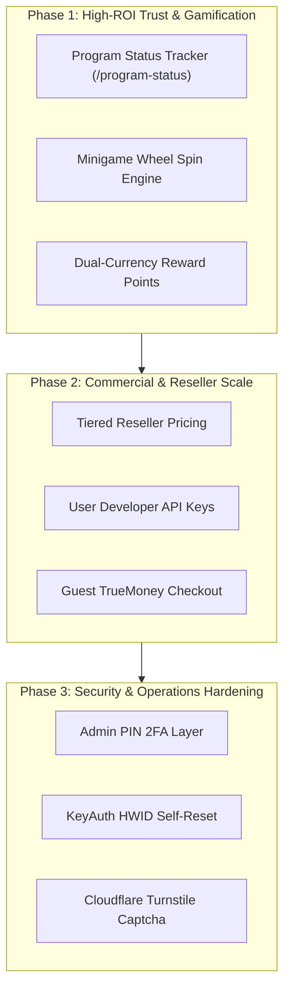

# 📊 Benchmark Audit & Feature Gap Matrix: Vexzy Model V vs WebShop NYX9

> **Document Type:** External Competitor Benchmark & Feature Gap Specification  
> **Source Target:** `https://vexzyez.vexzy.xyz/` (Vexzy Model V Storefront Engine)  
> **Audited By:** Antigravity AI Agent (Lead Orchestration)  
> **Current Reference:** [[02_Feature_Matrix|02_Feature_Matrix.md]] & [[00_Master_Index|Master Index]]

---

## 1. 🎯 Audit Metadata & Empirical Verification

| Parameter | Recorded Value / Verification |
| :--- | :--- |
| **Target URL** | `https://vexzyez.vexzy.xyz/` |
| **System Architecture** | Vite + React + React Router + DaisyUI 5 + Tailwind v4 + REST API (`/__api`) |
| **Live Probing Account** | Username: `testuser6010` \| Email: `testuser4408@gmail.com` \| ID: `27748` \| Role: `member` |
| **API Endpoints Mapped** | 35 Backend Endpoints mapped via `/assets/json/config.json` |
| **Client Chunks Analyzed** | 71 Unique JavaScript bundle chunks parsed (`main-DmqkHldB.js`, `ChatWidget`, `Minigames`, etc.) |
| **Current WebShop Baseline** | Vanilla HTML5/CSS3 + Tailwind + Supabase PostgreSQL + Serverless Cloudflare/Vercel API |

---

## 2. 📋 Master Comparison Table (21 Feature Gaps)

| # | Feature Domain | Vexzy Model V Capability | WebShop NYX9 Status | Priority Impact |
| :-: | :--- | :--- | :--- | :-: |
| 01 | **Gamification** | มินิเกมหมุนวงล้อสุ่มของรางวัล (`/minigames`, `/minigames/:id`) | ❌ ยังไม่มี | `Critical` |
| 02 | **Loyalty Points** | ระบบคะแนนสะสม 2 สกุลเงิน (`points` vs `money`) ซื้อสินค้าด้วยแต้ม | ❌ มีเฉพาะ Wallet Balance | `High` |
| 03 | **Installments** | ผ่อนชำระสินค้าเป็นงวด (`/installments`, `pay_installment`) | ❌ มีเฉพาะซื้อขาดทันที | `Medium` |
| 04 | **Program Status** | ติดตามสถานะโปรแกรม/สคริปต์ Real-time (`/program-status`) | ❌ ยังไม่มีหน้าติดตาม | `Critical` |
| 05 | **KeyAuth / HWID** | เชื่อมต่อ KeyAuth API และปุ่ม Reset HWID อัตโนมัติ (`/keyauth`) | ❌ ยังไม่มีการเชื่อมต่อ | `High` |
| 06 | **Live Chat** | วิดเจ็ตแชทสดสนทนากับแอดมินหน้าเว็บ (`ChatWidget`, `/admin/chats`) | ❌ ใช้ลิงก์ Ticket Discord | `Medium` |
| 07 | **Giveaways** | กิจกรรมแจกของรางวัลฟรีสำหรับสมาชิก (`/giveaway`) | ❌ ยังไม่มีระบบสุ่มแจก | `Medium` |
| 08 | **Developer API** | สร้าง Developer API Key ให้ลูกค้านำไปยิงซื้อ (`/api/user-api-key`) | ❌ ยังไม่มี User API Keys | `High` |
| 09 | **Tiered Reseller** | ระบบยศสมาชิกละเอียด & ราคาส่ง Reseller (`reseller_price`) | ❌ ราคาเดียว Whitelist ID | `High` |
| 10 | **Guest Purchase** | ซื้อแบบผู้เยี่ยมชมผ่านซองอั่งเปาไม่ต้องสมัครสมาชิก (`/purchase/guest`) | ❌ ต้องล็อกอินก่อน | `High` |
| 11 | **Pre-Order ID/Pass** | ฟอร์มสั่งซื้อที่เปิดให้กรอก ID/Pass เกมเฉพาะสินค้า (`preorder_with_idpass`) | ❌ ส่งรหัสผ่าน Vault ทันที | `Medium` |
| 12 | **Buy X Get Y** | โปรโมชั่นซื้อสินค้านี้แถมสินค้านั้น (`buy_and_get`, `get_product`) | ❌ มีเฉพาะคูปองส่วนลด | `Low` |
| 13 | **Background BGM** | เครื่องเล่นเพลงประกอบหน้าร้านพร้อมตัวปรับเสียง (`music_link`) | ❌ ไม่มีระบบเสียง BGM | `Low` |
| 14 | **Particle FX** | ระบบเอฟเฟกต์หน้าเว็บ (Oneko แมววิ่ง, หิมะตก, การ์ดทอง Aura/Aurora) | ❌ Cyber SVG Artwork | `Low` |
| 15 | **Fake Metrics** | ระบบปั๊มยอดสถิติหลอกหลังบ้าน (`fake_user`, `fake_topup`, `fake_sell`) | ❌ ข้อมูลจริง Supabase | `Low` |
| 16 | **Admin PIN 2FA** | รหัส PIN 6 หลักชั้นที่สองก่อนเข้าถึงแดชบอร์ด (`/admin/pin`) | ❌ Discord ID Whitelist | `High` |
| 17 | **Access Audit Log**| เก็บบันทึกประวัติ IP Address และอุปกรณ์ของแอดมิน (`/admin/access-history`) | ❌ ยังไม่มี IP Logging | `Medium` |
| 18 | **Income Tax Tool** | คำนวณรายได้สุทธิ, หักค่าธรรมเนียม และประมาณการภาษี (`/admin/income-tax`) | ❌ กราฟ Analytics ทั่วไป | `Low` |
| 19 | **FAQ CMS** | ระบบจัดการคำถามที่พบบ่อยหน้าบ้านและหลังบ้าน (`/api/faq`, `/admin/faq`) | ❌ ยังไม่มีหน้า FAQ | `Low` |
| 20 | **Captcha Auth** | ระบบยืนยันตัวตนกันบอทสมัครสแปมด้วย Cloudflare Turnstile (`turnstile`) | ❌ Rate Limiting ฝั่ง API | `Medium` |
| 21 | **Gateway Fees** | ตั้งค่าหักค่าธรรมเนียมแยกรายช่องทาง (`slip_fee`, `angpao_fee`) | ❌ ฟรีค่าธรรมเนียม 0% | `Low` |

---

## 3. 🔬 Deep-Dive Architectural Breakdown

### 3.1 Gamification & Minigames Engine
* **Vexzy Reference**: `assets/js/MinigameManagement-D54Rx5Ng.js` & `assets/js/MinigamePlayHistory-mZo5-Fsh.js`
* **Mechanics**:
  * รองรับทั้งการหมุนวงล้อเสี่ยงโชคด้วยยอดเงินกระเป๋า (`play_price`) หรือคะแนนสะสม (`play_with_points`)
  * ระบบจัดการสต็อกของรางวัลแยกชิ้น พร้อมสิทธิ์การรีเซ็ตสต็อกทั้งหมด
* **Proposed Adaptation for WebShop**:
  * สร้างตาราง `minigames` และ `minigame_rewards` บน Supabase โดยผูกของรางวัลเข้ากับ `credentials_vault` ชิ้นที่ยังไม่ขาย (`is_sold = false`).

### 3.2 Dual-Currency Loyalty Reward Points
* **Vexzy Reference**: `point_topup_enabled`, `point_topup_percent`, `point_reviews_enabled`, `buy_with_point`
* **Mechanics**:
  * เมื่อลูกค้าเติมเงินผ่าน PromptPay หรือ Slip ระบบจะ Cash-back คะแนน `points` เข้ากระเป๋าตามสัดส่วน %
  * เมื่อลูกค้ารีวิวสินค้าในหน้า [[FEAT_06_Order_Lookup_And_Warranty_Claim]] จะได้รับแต้มพิเศษ
  * สินค้าบางชิ้นสามารถสลับโหมดชำระเงินระหว่าง `Money` และ `Points` ได้
* **Proposed Adaptation for WebShop**:
  * เพิ่มคอลัมน์ `points NUMERIC DEFAULT 0` ในตาราง `users` ของ Supabase
  * อัปเดต `api/verify-slip.js` และ `api/truemoney-redeem.js` ให้คำนวณโบนัสแต้มสะสม

### 3.3 Live Program Status Monitor
* **Vexzy Reference**: `assets/js/ProgramStatus-BIsnjt1u.js` & `assets/js/ProgramStatusManagement-B9oSU57G.js`
* **Mechanics**:
  * แสดง Badge สถานะ: `online` (Safe/Undetected 🟢), `updating` (กำลังอัปเดต 🟡), `maintenance` (ปิดปรับปรุง 🟠), `detected` (อันตราย 🔴)
  * มีชื่อโปรแกรม, เวอร์ชั่น, รูปไอคอน, และลิงก์ดาวน์โหลดตัวรัน
* **Proposed Adaptation for WebShop**:
  * สร้างหน้าย่อยหรือโมดอล `Program Status Hub` เพื่อสร้างความเชื่อมั่นให้กับลูกค้าที่ซื้อ Roblox Scripts และ Discord Tools

### 3.4 KeyAuth Integration & HWID Reset
* **Vexzy Reference**: `/api/admin/keyauth`, `/api/keyauth/reset-hwid`, `/api/keyauth/sellers`
* **Mechanics**:
  * หน้าจัดการคีย์สำหรับโปรแกรมโกงหรือซอฟต์แวร์ป้องกันการแกะ
  * ลูกค้าสามารถกดย้ายเครื่องเล่นเกมได้เองผ่านระบบรีเซ็ต Hardware ID
* **Proposed Adaptation for WebShop**:
  * เชื่อมต่อ Serverless API ไปยัง KeyAuth Reseller API เพื่อจัดการ License อัตโนมัติ

### 3.5 Tiered Reseller Pricing & Granular RBAC
* **Vexzy Reference**: `can_access_reseller_price`, `reseller_price`, `RoleManagement-C3Nc_E4k.js`
* **Mechanics**:
  * กำหนดราคาส่ง `reseller_price` คู่กับราคาปลีก `price`
  * เมื่อผู้ใช้ที่มียศตัวแทนล็อกอินเข้าร้าน ราคาหน้าบัตรจะเปลี่ยนเป็นราคาส่งทันที
* **Proposed Adaptation for WebShop**:
  * เพิ่มคอลัมน์ `reseller_price` ใน `productsData.js` หรือตาราง `products` และแสดงป้ายราคาพิเศษเมื่อสิทธิ์ผ่าน

---

## 4. 🚀 Phased Roadmap Recommendation

---

## 5. 🔗 Vault References
- [[00_Master_Index|00_Master_Index.md]]
- [[02_Feature_Matrix|02_Feature_Matrix.md]]
- [[ARCH_01_Architecture_Audit|ARCH_01_Architecture_Audit.md]]
- [[FEAT_01_Instant_Credential_Delivery|FEAT_01_Instant_Credential_Delivery.md]]
- [[FEAT_03_Tri_Gateway_TopUp|FEAT_03_Tri_Gateway_TopUp.md]]
- [[FEAT_04_Smart_Slip_Verification|FEAT_04_Smart_Slip_Verification.md]]
