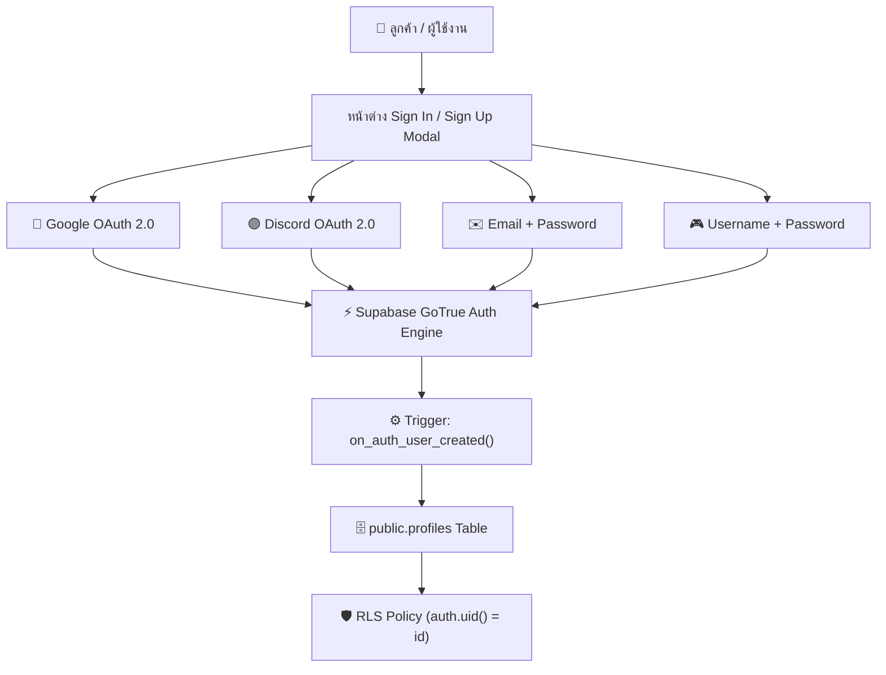

# 🛡️ NYX9 STUDIO — ENTERPRISE SECURITY & FINANCIAL VAULT
> **Document Version:** 2.0.0 (Production Hardened Release)  
> **System Classification:** Commercial Digital E-Commerce Architecture  
> **Security Protocol:** AES-256-GCM Encryption, Zero-Trust Pricing, Anti-Bot, ACID Row-Locking & Privilege Isolation  
> **Repository:** [https://github.com/MatTew-png/wichx-nyx-storefront](https://github.com/MatTew-png/wichx-nyx-storefront)

---

## 1. บทสรุปสถาปัตยกรรมความปลอดภัย 5 เสาหลัก (Financial Defense Suite)

1. **Cloudflare WAF & IP Cloaking:** ซ่อน Origin IP จริง 100% พร้อมจัดการ DNS Proxying (`wrangler.jsonc`, `_headers`), ป้องกัน DDoS, บังคับใช้ HSTS และ Security Headers (CSP, X-Frame-Options: DENY, X-Content-Type-Options: nosniff)
2. **Honeypot Anti-Bot Trap:** ดักจับสคริปต์สแปมล่องหนผ่านช่อง input ซ่อนใน Checkout & ฟอร์มบริการ หากบอทกรอกค่าเข้ามา ระบบจะปฏิเสธคำขอทันที
3. **Server-Side Price Authority:** สถาปัตยกรรม Zero-Trust ตัดสิทธิ์การกำหนดราคาจากฝั่ง Client 100% โดยเซิร์ฟเวอร์และ Stored Procedure คำนวณราคาจริงจากตาราง `products` ฝั่งฐานข้อมูลโดยตรง ปิดช่องโหว่ Inspect Element แก้ราคา
4. **Idempotency Key Lock & Anti-Double-Spend:** ป้องกันลูกค้าเน็ตกระตุกแล้วกดปุ่มชำระเงินซ้ำ และป้องกันการนำสลิปโอนเงินหรือซองของขวัญเดิมมาเคลมซ้ำผ่าน UNIQUE Constraint บน `used_payment_slips(slip_trans_ref)`
5. **AES-256-GCM Crypto Vault:** เข้ารหัสรหัสผ่านไอดีดิจิทัลก่อนบันทึกลงในคอลัมน์ `inventory_keys.credential_data` ด้วยอัลกอริทึม AES-256-GCM พร้อม IV และ Authentication Tag 16-byte ปลอดภัยแม้มีข้อมูลรั่วไหลในระดับฐานข้อมูล

---

## 2. ดัชนีสารบบฐานข้อมูล 12 ตาราง (Database Catalog) & RLS Policies

ทุกตารางเปิดใช้งาน **Row Level Security (RLS) 100% (12/12 ตาราง)** พร้อมห่อหุ้ม `auth.uid()` ในรูปแบบ `(SELECT auth.uid())` (InitPlan Subquery) เพื่อประสิทธิภาพสูงสุด:

| # | ตาราง | หน้าที่หลัก | ระดับความปลอดภัย & Constraints | RLS Policy |
|---|---|---|---|---|
| 1 | `profiles` | ยอดเงินในกระเป๋า (Wallet) และข้อมูลสมาชิก | `CHECK (balance >= 0)`, `UNIQUE(discord_id)` | เฉพาะเจ้าของไอดีหรือ Service Role อ่าน/แก้ไขได้ |
| 2 | `categories` | หมวดหมู่สินค้าทั้ง 4 หมวด | ควบคุมลำดับการแสดงผล `sort_order` | Public อ่านได้, แก้ไขได้เฉพาะ Admin |
| 3 | `products` | รายการสินค้า, ราคาจริง, ชิปไอคอน | ควบคุมการเปิด/ปิดด้วย `is_active` | Public อ่านเฉพาะที่ `is_active = true` |
| 4 | `inventory_keys` | คลังเก็บรหัสสินค้าดิจิทัล (เข้ารหัส AES-256) | มีดัชนีคัดแยกเฉพาะรหัสที่ยังไม่ขาย `is_sold = false` | **ปิดกั้น Anonymous 100% (0 Rows Leaked)** เฉพาะ Service Role / Stored Procedure เท่านั้น |
| 5 | `orders` | บันทึกคำสั่งซื้อหลัก | สถานะ `PAID`, `PENDING`, `REFUNDED` | เฉพาะเจ้าของออเดอร์อ่านประวัติของตนเองได้ |
| 6 | `order_items` | รายการสินค้าในแต่ละออเดอร์ | บันทึกรหัสที่ส่งมอบและฟอร์มบริการ | `delivered_content` เข้าถึงได้เฉพาะเจ้าของออเดอร์ |
| 7 | `topup_transactions` | ประวัติการเติมเงิน (PromptPay, TrueMoney, LTC) | ตรวจสอบย้อนหลังได้ทุกบาท ทุกเกตเวย์ | เฉพาะเจ้าของรายการและแอดมิน |
| 8 | `used_payment_slips` | ระบบป้องกันสลิปซ้ำ | รหัส `slip_trans_ref` ห้ามซ้ำเด็ดขาด (`UNIQUE`) | ตรวจจับการ Double-Spend ในระดับ Transaction |
| 9 | `promo_code_usages` | ระบบจำกัดสิทธิ์โค้ดส่วนลด | บังคับ `UNIQUE(user_id, code)` 1 คนใช้ได้ 1 ครั้ง | บันทึกประวัติการใช้คูปองรายบุคคล |
| 10 | `warranty_claims` | ระบบบันทึกคำร้องขอเคลมประกันสินค้า | ติดตามสถานะ `PENDING`, `RESOLVED`, `REJECTED` | บังคับใช้ `WITH CHECK (user_id = (SELECT auth.uid()))` |
| 11 | `blacklists` | ระบบแบนไอดีคนโกงและบอท | `UNIQUE(target_value)` แบนตาม IP, Discord, วอลเล็ต | ควบคุมการบล็อกคำสั่งซื้อและการเติมเงิน |
| 12 | `system_audit_logs` | บันทึกเหตุการณ์เซิร์ฟเวอร์ระดับละเอียด | บันทึกเหตุการณ์, IP, Payload สำหรับคลี่คลายข้อพิพาท | Append-Only เฉพาะระบบและ Stored Procedure |

---

## 3. สารบบ Stored Procedures & Atomic Functions

ฟังก์ชันทั้งหมดสร้างด้วย `SECURITY DEFINER` พร้อมตั้งค่า `search_path = public, pg_temp` เพื่อป้องกัน Search Path Injection และเพิกถอนสิทธิ์ (`REVOKE`) จาก Anonymous:

1. **`execute_order_checkout(p_order_id, p_items, p_total_amount, p_user_id, p_customer_info)`**:
   - ล็อกแถวสินค้าด้วย `FOR UPDATE SKIP LOCKED` บน `inventory_keys` ป้องกัน Race Condition
   - ตรวจสอบยอดเงินจริงใน `profiles.balance` และคำนวณราคาจริงจากตาราง `products`
   - ทำการตัดเงินในกระเป๋าและส่งมอบสินค้าในระดับ Single Transaction (ACID)
   - บันทึกลง `orders`, `order_items` และ `system_audit_logs`
2. **`process_topup(p_gateway, p_trans_ref, p_amount, p_user_id, p_raw_payload)`**:
   - ตรวจสอบความถูกต้องของสลิป/ซองของขวัญ และบันทึกลง `used_payment_slips`
   - ป้องกันการส่งสลิปซ้ำ (Anti-Double-Spend) ในระดับ Database Transaction
   - เพิ่มเครดิตเข้าสู่ `profiles.balance` แบบ Atomic
3. **`get_product_stock_counts()`**:
   - ฟังก์ชันสาธารณะสำหรับหน้าร้าน คืนค่าเฉพาะจำนวนสต็อกคงเหลือรวม (`product_id`, `in_stock_count`)
   - ไม่มีการเปิดเผยข้อมูลแถวหรือรหัสไอดีใน `inventory_keys` ให้ผู้ใช้งานภายนอก
4. **`admin_get_metrics(p_admin_secret)`**:
   - สรุปสถิติ Telemetry: ยอดขายรวม, จำนวนออเดอร์, สต็อกคงเหลือแยกรายสินค้า, ยอดเติมเงิน และเคสเคลมค้าง
   - จำกัดสิทธิ์เฉพาะ Authenticated Admin และ Service Role
5. **`admin_bulk_restock(p_admin_secret, p_product_id, p_raw_keys)`**:
   - เพิ่มสต็อกคีย์เข้ารหัสแบบชุดใหญ่ในครั้งเดียว
6. **`admin_resolve_claim(p_admin_secret, p_claim_id, p_status, p_replacement_key)`**:
   - จัดการปิดเคสเคลมประกันและส่งมอบคีย์ชดเชย
7. **`handle_new_user()`**:
   - ทริกเกอร์อัตโนมัติบน Supabase Auth สำหรับสร้างข้อมูลสมาชิกในตาราง `profiles` เมื่อล็อกอินผ่าน Discord ครั้งแรก

---

## 4. ดัชนีเพิ่มประสิทธิภาพการคิวรี (10 Covering Foreign Key Indexes)

เพื่อป้องกันการเกิด Table Scan ขนาดใหญ่เมื่อมีข้อมูลเพิ่มขึ้น:
1. `idx_products_category_id` ➔ `products(category_id)`
2. `idx_inventory_keys_product_id` ➔ `inventory_keys(product_id)`
3. `idx_inventory_keys_order_id` ➔ `inventory_keys(order_id)`
4. `idx_orders_user_id` ➔ `orders(user_id)`
5. `idx_order_items_order_id` ➔ `order_items(order_id)`
6. `idx_order_items_product_id` ➔ `order_items(product_id)`
7. `idx_topup_transactions_user_id` ➔ `topup_transactions(user_id)`
8. `idx_used_payment_slips_user_id` ➔ `used_payment_slips(user_id)`
9. `idx_promo_code_usages_user_id` ➔ `promo_code_usages(user_id)`
10. `idx_warranty_claims_order_id` ➔ `warranty_claims(order_id)`

---

## 5. การป้องกันฝั่ง Client & Admin Access Gate

- **Client Anti-Tamper:** ปิดกั้นการเปิดคลิกขวา (Context Menu), ป้องกันปุ่มลัด DevTools (F12, Ctrl+Shift+I, Ctrl+Shift+J, Ctrl+U) ใน Capture Phase
- **Admin Developer Bypass:** สามารถปลดล็อก DevTools สำหรับทีมพัฒนาได้ด้วยคีย์ลัด `Alt + Shift + D` หรือพิมพ์คำว่า `nyxdev`
- **Console Self-XSS Warning:** แสดงป้ายเตือนสีแดงใน Developer Console ป้องกันการถูกหลอกวางสคริปต์ขโมยโทเค็น
- **Discord OAuth Admin Whitelist:** ระบบตรวจสอบสิทธิ์แอดมินเทียบกับ Discord ID จริง (`483398326159671326`, `422611554475835394`)

---

## 6. เสาหลักความปลอดภัยระดับฐานข้อมูล & Edge Security (Security Hardening v2)

1. **Enforce Single-Use Promo Codes (Database Constraint):** 
   - บันทึกประวัติการใช้คูปองลงในตาราง `promo_code_usages` ในขั้นตอน `execute_order_checkout` โดยตรง
   - บังคับใช้กฎผ่านข้อจำกัด `UNIQUE(user_id, code)` ระดับฐานข้อมูล
   - หากตรวจพบว่าลูกค้ารายเดิมพยายามใช้โค้ดซ้ำ ฐานข้อมูลจะ Reject คำสั่งซื้อทันทีด้วยข้อผิดพลาด `PROMO_CODE_ALREADY_USED`

2. **Automated Blacklist Query in Transaction:** 
   - ดึงตาราง `blacklists` เข้าไปตรวจสอบอัตโนมัติใน `execute_order_checkout` และ `process_topup`
   - ตรวจสอบทั้ง `target_value` ของ Discord ID, User ID และ IP Address ของผู้ส่งคำขอ
   - หากตรงกับรายการบัญชีดำที่ยังไม่หมดอายุ ระบบจะบันทึก Critical Audit Log และปฏิเสธการทำรายการทันที (`BLACKLISTED_USER`)

3. **Edge Rate Limiting & Anti-Brute-Force:**
   - ติดตั้งตัวจำกัดอัตราคำขอ (`api/rate-limiter.js`) ในหน้า `/api/verify-slip`, `/api/truemoney-redeem` และ `/api/checkout`
   - จำกัด 5 requests / นาที ต่อ 1 IP (Sliding Window Algorithm)
   - ป้องกันการสุ่มหมายเลขอ้างอิงสลิป (TransRef) และซองของขวัญ TrueMoney หากยิงเกินโควตาจะได้รับ HTTP 429 `RATE_LIMIT_EXCEEDED` พร้อม Header `Retry-After`

4. **Unified Verification Test Suite (npm run test:verify):**
   - คำสั่งเดี่ยวตามแนวทาง pstack: `npm run test:verify` หรือ `npm test` เพื่อพิสูจน์ความสมบูรณ์ของระบบ
   - ทดสอบ RLS Leak, Zero-Trust Price recalculation, Anti-Dupe Slips/Vouchers, Promo Code Constraint, Blacklist Auto-Query และ Edge Rate Limiting
   - ผสานเข้ากับ GitHub Actions (`.github/workflows/deploy.yml`) เพื่อรันตรวจสอบอัตโนมัติก่อน Deploy ขึ้น Production ทุกครั้ง

---

## 7. แผนผังสถาปัตยกรรมระบบยืนยันตัวตน Tier 1 (Unified Auth Vault & Specification)

พิมพ์เขียวระบบล็อกอินครบวงจรสำหรับ NYX9 Studio WebShop รองรับทั้งบุคคลทั่วไปและสายเกมเมอร์ ออกแบบให้เปิดใช้งานร่วมกับ Supabase Auth และ PostgreSQL RLS ได้ทันที:



### 7.1 รายละเอียดและขั้นตอนการทำงาน 4 รูปแบบหลัก (Tier 1 Suite)

#### 1. 🔴 Google Sign-In (OAuth 2.0 / OIDC)
* **จุดประสงค์**: ความสะดวกรวดเร็วสูงสุด คลิกเดียวเข้าใช้งานได้ทันที ครอบคลุมผู้ใช้ 95%+
* **ข้อมูลที่ดึงได้**: `email`, `full_name`, `avatar_url`, `sub` (Google User ID)
* **ขั้นตอนเตรียมการ (Config Checklist)**:
  1. สร้าง OAuth Client ID & Secret บน [Google Cloud Console](https://console.cloud.google.com/apis/credentials)
  2. ใส่ Authorized redirect URIs: `https://<PROJECT-REF>.supabase.co/auth/v1/callback`
  3. นำ Client ID และ Secret ไปเปิดใช้งานที่ Supabase Dashboard -> Authentication -> Providers -> Google

#### 2. 🟣 Discord Sign-In (OAuth 2.0)
* **จุดประสงค์**: ตอบโจทย์กลุ่มลูกค้าหลักของร้าน (Discord Nitro, FiveM, Script, Bot, Gaming Accounts)
* **ข้อมูลที่ดึงได้**: `discord_id`, `username`, `discriminator`, `avatar`, `email` (ถ้ามี)
* **ประโยชน์เชิงธุรกิจ**:
  - ดึง `discord_id` มาบันทึกลง `profiles.discord_id` เพื่อใช้ส่งบอท Discord แจกยศ VIP หรือส่งรหัสสินค้าเข้า DM อัตโนมัติ
* **ขั้นตอนเตรียมการ (Config Checklist)**:
  1. เข้า [Discord Developer Portal](https://discord.com/developers/applications) -> สร้าง Application
  2. เมนู OAuth2 -> เพิ่ม Redirect URL: `https://<PROJECT-REF>.supabase.co/auth/v1/callback`
  3. คัดลอก Client ID และ Client Secret ไปใส่ใน Supabase Dashboard -> Authentication -> Providers -> Discord

#### 3. ✉️ Email + Password (สมัครเองแบบสากล)
* **จุดประสงค์**: สำหรับลูกค้าที่ต้องการแยกบัญชีส่วนตัว ไม่อยากผูก Social Media
* **ฟีเจอร์ความปลอดภัย**:
  - รหัสผ่านถูกแฮชระดับสากลด้วย `bcrypt` ฝั่ง Supabase
  - มีระบบ Email Confirmation (ส่งลิงก์ยืนยันตัวตน)
  - มีระบบ Password Recovery (ส่งลิงก์รีเซ็ตรหัสผ่านผ่านอีเมลเมื่อลืม)

#### 4. 🎮 Username + Password (สมัครเองแบบสายเกมเมอร์ ไม่ต้องใช้อีเมล)
* **จุดประสงค์**: สมัครเร็วที่สุดใน 10 วินาที เหมาะกับวัยรุ่นหรือเกมเมอร์ที่ไม่อยากเปิดเช็คอีเมล
* **รูปแบบการทำงาน (2 รูปแบบย่อย)**:
  * **Option A (แนะนำ - Username ควบคู่ Email สำรอง)**: กรอก `Username` สำหรับใช้แสดงผลและล็อกอิน + กรอก `Email` สำรองไว้สำหรับกู้รหัสผ่านและรับใบเสร็จ
  * **Option B (Pure Username)**: ผู้ใช้กรอกแค่ `Username` + `Password` ฝั่งระบบจะสร้าง Synthetic Email อัตโนมัติ เช่น `username@local.nyx9.shop` ส่งเข้า `auth.users` เพื่อรักษาความสมบูรณ์ของโครงสร้างความปลอดภัยและ RLS

---

### 7.2 โครงสร้างฐานข้อมูลรองรับระบบล็อกอิน (Database Schema & Migration Spec)

เมื่อต้องการเริ่มทำ ให้รันคำสั่ง SQL ด้านล่างเพื่ออัปเกรดตาราง `profiles` และสร้าง Trigger อัตโนมัติ:

```sql
-- 1. เพิ่มคอลัมน์ username, email, avatar_url, auth_provider ลงใน public.profiles
ALTER TABLE public.profiles
ADD COLUMN IF NOT EXISTS username VARCHAR(50) UNIQUE,
ADD COLUMN IF NOT EXISTS email VARCHAR(255),
ADD COLUMN IF NOT EXISTS avatar_url TEXT,
ADD COLUMN IF NOT EXISTS auth_provider VARCHAR(30) DEFAULT 'email';

-- 2. สร้าง Index สำหรับการค้นหาด้วย username และ email อย่างรวดเร็ว
CREATE INDEX IF NOT EXISTS idx_profiles_username ON public.profiles(username);
CREATE INDEX IF NOT EXISTS idx_profiles_email ON public.profiles(email);

-- 3. อัปเกรดฟังก์ชัน handle_new_user() ให้รองรับ Provider ครบทุกประเภท
CREATE OR REPLACE FUNCTION public.handle_new_user()
RETURNS TRIGGER 
SECURITY DEFINER
SET search_path = public, pg_temp
LANGUAGE plpgsql
AS $$
DECLARE
  v_username TEXT;
  v_avatar TEXT;
  v_provider TEXT;
  v_discord_id TEXT;
BEGIN
  -- ดึง provider จาก raw_app_meta_data
  v_provider := COALESCE(NEW.raw_app_meta_data->>'provider', 'email');
  
  -- ดึง Discord ID หรือสร้าง username เริ่มต้นตาม Provider
  IF v_provider = 'discord' THEN
    v_discord_id := NEW.raw_user_meta_data->>'provider_id';
    v_username := COALESCE(NEW.raw_user_meta_data->>'full_name', NEW.raw_user_meta_data->>'name', 'User_' || substr(NEW.id::text, 1, 6));
    v_avatar := NEW.raw_user_meta_data->>'avatar_url';
  ELSIF v_provider = 'google' THEN
    v_username := COALESCE(NEW.raw_user_meta_data->>'full_name', split_part(NEW.email, '@', 1));
    v_avatar := NEW.raw_user_meta_data->>'avatar_url';
  ELSE
    -- กรณี Email หรือ Username ตรงๆ
    v_username := COALESCE(NEW.raw_user_meta_data->>'username', split_part(NEW.email, '@', 1));
    v_avatar := 'https://api.dicebear.com/7.x/bottts/svg?seed=' || v_username;
  END IF;

  -- บันทึกลงตาราง profiles
  INSERT INTO public.profiles (
    id,
    discord_id,
    username,
    email,
    avatar_url,
    balance,
    auth_provider
  )
  VALUES (
    NEW.id,
    v_discord_id,
    v_username,
    NEW.email,
    v_avatar,
    0.00,
    v_provider
  )
  ON CONFLICT (id) DO UPDATE SET
    email = EXCLUDED.email,
    avatar_url = COALESCE(public.profiles.avatar_url, EXCLUDED.avatar_url),
    auth_provider = EXCLUDED.auth_provider;

  RETURN NEW;
END;
$$;

-- 4. ตั้ง Trigger บน auth.users เมื่อมีผู้ใช้ใหม่สมัครสมาชิก
DROP TRIGGER IF EXISTS on_auth_user_created ON auth.users;
CREATE TRIGGER on_auth_user_created
  AFTER INSERT ON auth.users
  FOR EACH ROW EXECUTE FUNCTION public.handle_new_user();
```

---

### 7.3 ตัวอย่างการเรียกใช้งานผ่าน JavaScript (`@supabase/supabase-js`)

```javascript
// A. ล็อกอินด้วย Google OAuth
async function signInWithGoogle() {
  const { data, error } = await supabase.auth.signInWithOAuth({
    provider: 'google',
    options: {
      redirectTo: window.location.origin
    }
  });
}

// B. ล็อกอินด้วย Discord OAuth
async function signInWithDiscord() {
  const { data, error } = await supabase.auth.signInWithOAuth({
    provider: 'discord',
    options: {
      redirectTo: window.location.origin
    }
  });
}

// C. สมัครสมาชิกด้วย Username + Password (+ Email ทางเลือก)
async function signUpWithUsername(username, password, email = null) {
  // หากไม่มีอีเมล ให้สร้าง synthetic email หลังบ้าน
  const targetEmail = email || `${username.toLowerCase().replace(/[^a-z0-9]/g, '')}@user.nyx9.shop`;
  
  const { data, error } = await supabase.auth.signUp({
    email: targetEmail,
    password: password,
    options: {
      data: {
        username: username
      }
    }
  });
  return { data, error };
}

// D. ล็อกอินด้วย Username หรือ Email + Password
async function signInWithUsernameOrEmail(identifier, password) {
  let targetEmail = identifier;
  
  // ถ้ากรอกมาเป็น Username (ไม่มีเครื่องหมาย @) ให้แปลงเป็น synthetic email หรือค้นหา email จาก profiles
  if (!identifier.includes('@')) {
    targetEmail = `${identifier.toLowerCase().replace(/[^a-z0-9]/g, '')}@user.nyx9.shop`;
  }

  const { data, error } = await supabase.auth.signInWithPassword({
    email: targetEmail,
    password: password
  });
  return { data, error };
}
```

---

### 7.4 มาตรการความปลอดภัยและป้องกันสแปม (Auth Security Guardrails)
1. **Cloudflare Turnstile (Invisible Captcha)**: ติดตั้งในหน้าฟอร์มสมัครไอดี เพื่อป้องกันบอทยิงสมัคร Username ขยะรัวๆ
2. **Rate Limiting**: จำกัดการลองรหัสผ่านผิดเกิน 5 ครั้ง ต่อ 15 นาที เพื่อป้องกัน Brute-force Attack
3. **Password Complexity Rule**: กำหนดรหัสผ่านขั้นต่ำ 8 ตัวอักษร
4. **Session Persistence**: จัดการ Token ใน LocalStorage ผ่าน Supabase Client พร้อม Auto-Refresh ปลอดภัยตามมาตรฐาน OAuth 2.0 / PKCE Flow
