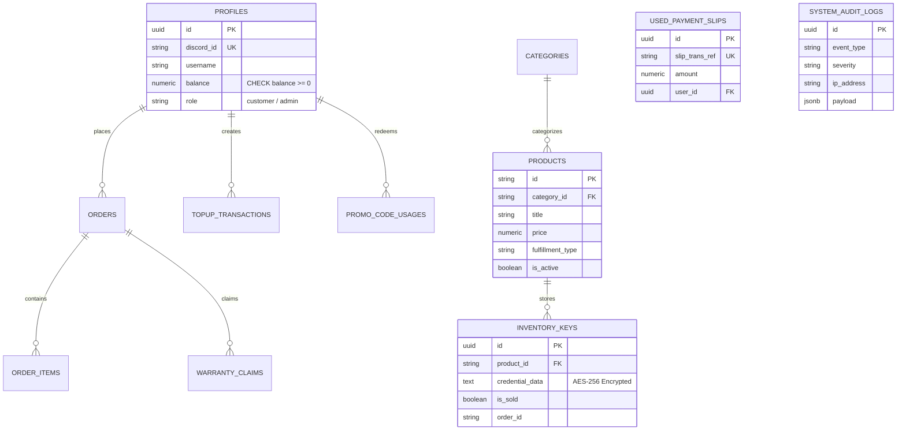

# 📐 NYX9 STUDIO — MASTER PRODUCTION BLUEPRINT
> **Document Version:** 1.0.0 (Production Release)  
> **System Architecture:** Serverless E-Commerce & Armored Financial Engine  
> **Target Production Domain:** `https://nyxning.shop/`  
> **Repository:** [https://github.com/MatTew-png/wichx-nyx-storefront](https://github.com/MatTew-png/wichx-nyx-storefront)

---

## 1. 🗺️ SITEMAP & USER NAVIGATION ARCHITECTURE

ระบบโครงสร้างเส้นทางและหน้าต่างการทำงาน (Single Page Application Flow with Modals):

```mermaid
flowchart TD
    Landing["/ (หน้าหลัก: Single Page Catalog)"] --> Hero["Hero Promo Banner Carousel"]
    Landing --> Marquee["Top System Broadcast Ticker"]
    Landing --> Telemetry["4-Metric Telemetry Grid"]
    Landing --> Filter["Category Filter Bar (Eye Toggles)"]
    
    Landing --> Catalog["Product Catalog (4 Categories)"]
    Catalog --> C1["🚀 Discord Nitro & Boosts"]
    Catalog --> C2["⚙️ Discord Services & Accounts"]
    Catalog --> C3["🎮 Gaming Accounts & Streaming Apps"]
    Catalog --> C4["📦 Uncategorized Standalone Items"]

    Landing --> Modals["Interactive Floating Surfaces"]
    Modals --> CartDrawer["Slide-Out Cart Drawer (Checkout + Coupons)"]
    Modals --> InstantModal["Instant Key & Credential Delivery Modal"]
    Modals --> ServiceModal["Custom Discord Service Form Modal"]
    Modals --> TopUpModal["Tri-Gateway Top-Up Modal (PromptPay / TrueMoney / LTC)"]
    Modals --> ClaimModal["Warranty Ticket & Dispute Modal"]
    Modals --> SocialProof["Recent Purchases Live Feed (Bottom-Left)"]
```

### รายการ URL & Static Endpoints:
- `https://nyxning.shop/` — หน้าร้านหลัก แคตตาล็อกสินค้า และระบบสั่งซื้อ
- `https://nyxning.shop/sitemap.xml` — แผนผังเว็บไซต์สำหรับ Search Engine
- `https://nyxning.shop/robots.txt` — กฎการเข้าถึงของ Web Crawlers

---

## 2. 🗄️ DATABASE SCHEMA (SUPABASE POSTGRESQL)

ฐานข้อมูลระบบแบ่งออกเป็น **12 ตารางหลัก** พร้อมฟังก์ชันตัดสต็อกระดับ Atomic:

### รายการตารางทั้งหมด 12 ตาราง:
1. `profiles`: สมาชิกและยอดเงินคงเหลือในกระเป๋า (ห้ามติดลบ)
2. `categories`: หมวดหมู่สินค้า 4 หมวด
3. `products`: รายการสินค้า ราคา ชิปไอคอน สถานะเปิด/ปิด
4. `inventory_keys`: คลังรหัส/คีย์ดิจิทัล เข้ารหัสแบบ AES-256
5. `orders`: ข้อมูลคำสั่งซื้อและสถานะการชำระ
6. `order_items`: รายการสินค้าย่อยในคำสั่งซื้อ
7. `topup_transactions`: บันทึกการเติมเงินทุกช่องทาง
8. `used_payment_slips`: ป้องกันการเอาสลิปโอนเงินมาใช้ซ้ำ (Unique Constraint)
9. `promo_code_usages`: จำกัดสิทธิ์การใช้โค้ดส่วนลด 1 คน / 1 สิทธิ์
10. `warranty_claims`: ระบบบันทึกคำร้องขอเคลมประกันสินค้า
11. `blacklists`: ระบบแบนคนโกงตาม IP, Discord ID, เบอร์กระเป๋า
12. `system_audit_logs`: เซิร์ฟเวอร์ล็อกเก็บหลักฐานการทำรายการแบบละเอียด

---

## 3. 🎨 CONTENT & ASSETS SPECIFICATION

- **อัตราส่วนภาพสินค้า (Aspect Ratio):** **16:9** เวกเตอร์ SVG Cyberpunk Hologram สร้างในตัวระดับ Retina ไม่ต้องพึ่งพาภาพภายนอกที่อาจโหลดไม่ติด
- **Typography Pairing:**
  - หัวข้อ (Headings): `'Space Grotesk'` (น้ำหนัก 700–800)
  - เนื้อหาและ UI (Body): `'IBM Plex Sans Thai'` (น้ำหนัก 400–600)
  - ตัวเลข รหัส และราคา: `'JetBrains Mono'` (น้ำหนัก 600–700)
- **Palette Tokens:**
  - Base Canvas: Deep Obsidian Void (`#06080C`)
  - Primary Accent: Glacier Cyan (`#19BAFF`)
  - Accent Hover & Glow: Neon Cyan (`#38D4FF`)
  - Surface Card: Deep Slate (`#0E131D`, Hover `#131926`)
- **Tone of Voice & Copywriting:**
  - กระชับ ไร้เวิ่นเว้อ ใช้ **Icon Chips** สรุปจุดเด่น เช่น `[⚡ ส่งทันที]`, `[🛡️ ประกันเต็ม]`, `[💎 2 บูส]`

---

## 4. ⚡ API / SERVICE SPECIFICATION

สถาปัตยกรรม Serverless REST API ในโฟลเดอร์ `/api/`:

| Endpoint | Method | ความรับผิดชอบหลัก | มาตรการความปลอดภัย |
|---|---|---|---|
| `/api/checkout` | POST | ประมวลผลคำสั่งซื้อ, ตัดยอดเงิน Wallet | ตรวจจับ Honeypot, คำนวณราคาจริงจากเซิร์ฟเวอร์, Idempotency-Key |
| `/api/verify-slip` | POST | ตรวจสอบสลิป PromptPay อัตโนมัติ | ป้องกันสลิปซ้ำผ่าน `used_payment_slips`, บันทึก Transaction ID |
| `/api/truemoney-redeem`| POST | รับเงินจากซองของขวัญ TrueMoney | ตรวจสอบ URL Hash ซองของขวัญ ป้องกันการส่งซองเปล่า |
| `/api/crypto-ltc` | POST | ตรวจจับบล็อกเชน Litecoin (LTC) | ตรวจจับ 1 Confirmation บน Public Blockchain, บวกโบนัส +5% |
| `/api/discord-notify` | POST | ส่ง Embed แจ้งเตือนเข้า Discord | ส่งผ่าน Discord Webhook พร้อมสรุปรายการสินค้าและ Order ID |
| `crypto-vault.js` | Module| ฟังก์ชันเข้ารหัส/ถอดรหัสรหัสผ่านไอดี | ใช้อัลกอริทึม **AES-256-GCM** พร้อม IV และ Auth Tag |

---

## 5. 🌐 DOMAIN NAME CONFIGURATION (`nyxning.shop`)

- **Domain Registrar:** Hostinger (เป็นเจ้าของและต่ออายุถึง 2027-11-01)
- **DNS Management:** Cloudflare DNS (`aitana.ns.cloudflare.com`, `alan.ns.cloudflare.com`)
- **DNS Records Mapping:**
  - `CNAME` `@` (Root) ➔ `cname.vercel-dns.com` (Proxy: Proxied ☁️)
  - `CNAME` `www` ➔ `cname.vercel-dns.com` (Proxy: Proxied ☁️)
  - `TTL`: Auto

---

## 6. ☁️ HOSTING / CLOUD INFRASTRUCTURE

- **Hosting Platform:** **Vercel Edge Network** (ฟรี 100% สำหรับ Starter)
- **สถาปัตยกรรม:** JAMstack + Serverless Functions
- **Bandwidth Budget:** 100 GB/เดือน (รองรับการเปิดหน้าเว็บหลายแสนครั้ง)
- **Function Execution Timeout:** 10 วินาทีต่อคำขอ (เฉลี่ยใช้งานจริงเพียง 50–120ms)
- **High Availability:** กระจาย CDN แคชทั่วโลก โหลดหน้าเว็บเร็วระดับมิลลิวินาที

---

## 7. 🔒 SSL CERTIFICATE & HTTPS ENCRYPTION

- **SSL Provider:** Cloudflare Edge Certificates + Vercel Let's Encrypt
- **SSL Mode:** **Full (Strict)** เพื่อการเข้ารหัส 100% ตั้งแต่เบราว์เซอร์ไปจนถึงเซิร์ฟเวอร์
- **Min TLS Version:** **TLS 1.3**
- **HTTP Strict Transport Security (HSTS):** เปิดใช้งานเพื่อบังคับใช้ HTTPS ตลอดเวลา
- **Automatic Renewal:** ต่ออายุใบรับรองอัตโนมัติ ไม่ต้องกังวลเรื่องเว็บหมดอายุ

---

## 8. 🛠️ TECH STACK SELECTION JUSTIFICATION

| เทคโนโลยี | เหตุผลที่เลือกใช้ |
|---|---|
| **HTML5 + Vanilla JS (ES6+)** | เร็วที่สุดในโลก โหลดขึ้นมาทำงานทันที Zero-Bundle Bloat ไม่ต้องรอ React/Next.js hydration |
| **Tailwind CSS (JIT Engine)** | สร้าง Utility คลาสได้รวดเร็ว ปรับแต่งธีมสี Glacier Cyan & Glassmorphism ได้ง่าย |
| **Node.js Serverless Functions** | รันเฉพาะตอนมีคนกดซื้อหรือเติมเงิน ไม่กินทรัพยากรเครื่อง ไม่ต้องเสียค่าเช่ารายเดือน |
| **Supabase PostgreSQL** | ความแม่นยำทางการเงินระดับ ACID, มีระบบ Atomic Row Locking ป้องกันสต็อกซ้ำ |

---

## 9. 🐙 VERSION CONTROL (GIT & GITHUB CI/CD)

- **Repository:** `https://github.com/MatTew-png/wichx-nyx-storefront`
- **Branching Strategy:** `main` (Production Branch)
- **Automated CI Workflow:** [`.github/workflows/deploy.yml`](file:///c:/Users/_newgen/Documents/antigravity/WebShop/.github/workflows/deploy.yml)
  - ทำการทดสอบ Syntax ของ JavaScript, API Handlers และ Frontend ทุกครั้งที่มีการ Push Code

---

## 10. 🔐 ENVIRONMENT VARIABLES SPECIFICATION (`.env`)

| Key | ประเภท | วัตถุประสงค์ |
|---|---|---|
| `DISCORD_WEBHOOK_URL` | ความลับ (Server) | ลิงก์ Webhook สำหรับส่งแจ้งเตือนออเดอร์ใหม่เข้าห้อง Discord |
| `SLIP_VERIFY_API_KEY` | ความลับ (Server) | คีย์สำหรับเชื่อมต่อ OpenSlipVerify / EasySlip API |
| `TRUEMONEY_PHONE` | ความลับ (Server) | เบอร์โทรศัพท์สำหรับรับยอดเงินซองของขวัญอัตโนมัติ |
| `LTC_PUBLIC_ADDRESS` | สาธารณะ | ที่อยู่กระเป๋า Litecoin สำหรับรับโอนเหรียญ |
| `VAULT_ENCRYPTION_KEY`| ความลับสูงสุด | คีย์ 32 bytes สำหรับเข้ารหัสรหัสผ่านไอดีด้วย AES-256 |
| `ADMIN_SECRET_KEY` | ความลับ (Server) | รหัสผ่านแอดมินสำหรับกดยกเลิกหรือแทรกแซงระบบ |

---

## 11. 🔍 BASIC SEARCH ENGINE OPTIMIZATION (SEO)

- **Canonical URL:** `https://nyxning.shop/`
- **Meta Description & Keywords:** รองรับคีย์เวิร์ด Discord Nitro, FiveM, GTA V, เควสดิสคอร์ด
- **OpenGraph & Twitter Cards:** แสดงผลสวยงามเวลาแชร์ลิงก์ลง Discord, Facebook, หรือ Twitter/X
- **JSON-LD Structured Data:** มาร์กอัป Schema.org ประเภท `OnlineStore` แจ้งเตือน Search Engine ถึงการเปิดบริการ 24 ชม.
- **Sitemap & Robots Directives:** ชี้ทาง Google Bot ให้จัดทำดัชนีหน้าร้านหลัก และปิดกั้นโฟลเดอร์ `/api/`

---

## 12. 📊 ANALYTICS & TELEMETRY TRACKING

- **Event Tracker (`trackAnalyticsEvent`):**
  - ติดตามเหตุการณ์: `PURCHASE_SUCCESS`, `TOPUP_SUCCESS`, `CLAIM_SUBMITTED`
- **Privacy-Friendly:** ไม่เก็บข้อมูลส่วนตัวของลูกค้า ไม่ใช้ Third-party Tracking Cookies
- **Real-time Social Proof Feed:** แสดงยอดซื้อสดที่มุมจอซ้ายล่างทุก 8–10 วินาที เพื่อเพิ่ม Conversion Rate
