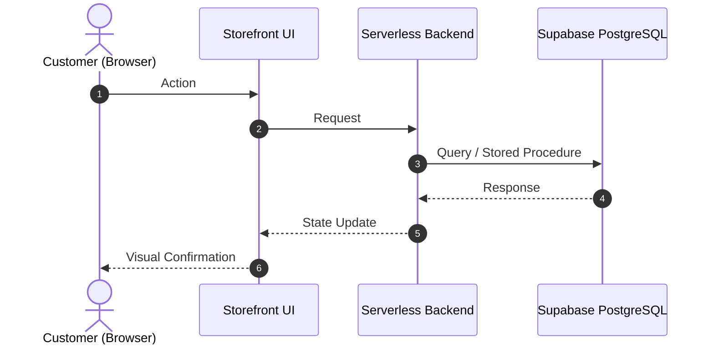

# 🚀 Feature Specification: <% tp.file.title %>

## 1. 🎯 Overview & User Problem
- **User Pain Point:** <% tp.file.cursor(3) %>
- **Target Value:** 

---

## 2. 🔄 Interaction Flow & Sequence

---

## 3. 🛡️ Security, Validation & Anti-Fraud Checklist
- [ ] Honeypot anti-bot verification included
- [ ] Server-side price authority enforced (Zero-Trust)
- [ ] Idempotency lock applied for duplicate prevention
- [ ] Input sanitization on all text fields

---

## 4. 🧪 Empirical Verification Steps
1. Navigate to target interface.
2. Trigger action with test payload.
3. Verify state transition and database mutation.
